<picture>
  <source media="(prefers-color-scheme: dark)" srcset=".github/assets/header-dunkel.svg">
  
</picture>

    

<h3 align="center">A full studio for voice, video and design. Free, open source, on your own machine.</h3>

Open-source tools for creators who build with AI: voice, video, images, design and motion. Picked from 6,600+ starred repos for one question: does it make better content faster?

## Start here

No time for 45 repos? These 4 cover the whole loop. Add the rest when you feel the gap.

| Role | Pick | Why |
|:--|:--|:--|
| **Ears** | [whisper](https://github.com/openai/whisper) `★ 111.5k` | turns every recording into searchable text |
| **Edit** | [remotion](https://github.com/remotion-dev/remotion) `★ 68.6k` | makes videos from code, so agents can cut them |
| **Pictures** | [ComfyUI](https://github.com/Comfy-Org/ComfyUI) `★ 143.8k` | builds image and video pipelines node by node |
| **Interface** | [ui](https://github.com/shadcn-ui/ui) `★ 126.8k` | gives every tool you ship a clean face |

<picture>
  <source media="(prefers-color-scheme: dark)" srcset=".github/assets/map-dunkel.svg">
  
</picture>

## Contents

- [Voice and speech](#voice-and-speech) · 11
- [Video and motion](#video-and-motion) · 10
- [Images](#images) · 5
- [Design and UI](#design-and-ui) · 8
- [Motion for the web](#motion-for-the-web) · 5
- [Writing and publishing](#writing-and-publishing) · 6

## Voice and speech

Clone, generate and transcribe voices.

- **[whisper](https://github.com/openai/whisper)** `★ 111.5k` · Robust speech recognition.
- **[faster-whisper](https://github.com/SYSTRAN/faster-whisper)** `★ 26.3k` · Whisper, up to four times faster.
- **[whisperX](https://github.com/m-bain/whisperX)** `★ 24.9k` · Word-level timestamps and speaker diarisation.
- **[TTS](https://github.com/coqui-ai/TTS)** `★ 46.2k` · Deep-learning text-to-speech toolkit.
- **[GPT-SoVITS](https://github.com/RVC-Boss/GPT-SoVITS)** `★ 64.1k` · Few-shot voice cloning and TTS.
- **[OpenVoice](https://github.com/myshell-ai/OpenVoice)** `★ 38.1k` · Instant voice cloning with tone control.
- **[VibeVoice](https://github.com/microsoft/VibeVoice)** `★ 55k` · Long-form, multi-speaker speech generation.
- **[index-tts](https://github.com/index-tts/index-tts)** `★ 24.8k` · Controllable, expressive zero-shot TTS.
- **[voicebox](https://github.com/jamiepine/voicebox)** `★ 58.9k` · Local voice studio for cloning and editing.
- **[Handy](https://github.com/cjpais/Handy)** `★ 35k` · Offline speech-to-text that types where you work.
- **[VoiceStudio](https://github.com/debpalash/VoiceStudio)** `★ 93k` · Fully local voice studio: cloning, design and speech without the cloud.

<a href="#contents">back to contents</a>

## Video and motion

From script to finished cut, as code.

- **[remotion](https://github.com/remotion-dev/remotion)** `★ 68.6k` · Make videos programmatically with React.
- **[manim](https://github.com/3b1b/manim)** `★ 95.8k` · Mathematical animations, the 3Blue1Brown way.
- **[OpenMontage](https://github.com/calesthio/OpenMontage)** `★ 72.7k` · Agentic video editing pipeline.
- **[Open-Sora](https://github.com/hpcaitech/Open-Sora)** `★ 29.9k` · Open text-to-video generation.
- **[pyvideotrans](https://github.com/jianchang512/pyvideotrans)** `★ 19.6k` · Translate and dub videos end to end.
- **[Duix-Avatar](https://github.com/duixcom/Duix-Avatar)** `★ 16.1k` · Open-source digital human avatars.
- **[obs-studio](https://github.com/obsproject/obs-studio)** `★ 78.5k` · Recording and live streaming.
- **[hyperframes](https://github.com/heygen-com/hyperframes)** `★ 74.8k` · Write HTML, render video. Built for agents.
- **[OpenCut](https://github.com/OpenCut-app/OpenCut)** `★ 96.7k` · Open-source video editor in the spirit of CapCut.
- **[MoneyPrinterTurbo](https://github.com/harry0703/MoneyPrinterTurbo)** `★ 136.1k` · Turns a topic into a finished short video with script, voice and footage.

<a href="#contents">back to contents</a>

## Images

Generate, edit and upscale.

- **[ComfyUI](https://github.com/Comfy-Org/ComfyUI)** `★ 143.8k` · Node-based image and video generation.
- **[Fooocus](https://github.com/lllyasviel/Fooocus)** `★ 53.7k` · Focus on prompting, not settings.
- **[stable-diffusion-webui](https://github.com/AUTOMATIC1111/stable-diffusion-webui)** `★ 165.2k` · The classic Stable Diffusion web UI.
- **[upscayl](https://github.com/upscayl/upscayl)** `★ 51.2k` · Free AI image upscaler for desktop.
- **[sharp](https://github.com/lovell/sharp)** `★ 32.8k` · High-performance image processing for Node.

<a href="#contents">back to contents</a>

## Design and UI

Interfaces with taste.

- **[ui](https://github.com/shadcn-ui/ui)** `★ 126.8k` · Beautiful, accessible components you own.
- **[impeccable](https://github.com/pbakaus/impeccable)** `★ 92.7k` · Design skills that make agents build better UI.
- **[ui-ux-pro-max-skill](https://github.com/nextlevelbuilder/ui-ux-pro-max-skill)** `★ 142.1k` · UI and UX design intelligence for agents.
- **[taste-skill](https://github.com/Leonxlnx/taste-skill)** `★ 104.5k` · Give your coding agent design taste.
- **[open-design](https://github.com/nexu-io/open-design)** `★ 104.7k` · Open-source AI design workspace.
- **[Awesome-Design-Tools](https://github.com/goabstract/Awesome-Design-Tools)** `★ 41.7k` · The big list of design tools.
- **[archify](https://github.com/tt-a1i/archify)** `★ 91k` · Agent skill that turns an idea or codebase into an interactive diagram.
- **[diagram-design](https://github.com/cathrynlavery/diagram-design)** `★ 62.5k` · Editorial diagram style for Claude Code, Codex and Cursor.

<a href="#contents">back to contents</a>

## Motion for the web

Small animations, big effect.

- **[anime](https://github.com/juliangarnier/anime)** `★ 74k` · Lightweight JavaScript animation engine.
- **[animate.css](https://github.com/animate-css/animate.css)** `★ 82.9k` · Drop-in CSS animations.
- **[three.js](https://github.com/mrdoob/three.js)** `★ 117.1k` · 3D on the web.
- **[lottie-ios](https://github.com/airbnb/lottie-ios)** `★ 26.9k` · Native playback of After Effects animations.
- **[WebGL-Fluid-Simulation](https://github.com/PavelDoGreat/WebGL-Fluid-Simulation)** `★ 16.8k` · The fluid simulation everyone remembers.

<a href="#contents">back to contents</a>

## Writing and publishing

Words that sound like you.

- **[humanizer](https://github.com/blader/humanizer)** `★ 62k` · Remove the tell-tale signs of AI writing.
- **[avoid-ai-writing](https://github.com/conorbronsdon/avoid-ai-writing)** `★ 5.3k` · A style guide against AI cliches.
- **[marketingskills](https://github.com/coreyhaines31/marketingskills)** `★ 57.1k` · Marketing skills for coding agents.
- **[ppt-master](https://github.com/hugohe3/ppt-master)** `★ 70.2k` · Generate slide decks with AI.
- **[last30days-skill](https://github.com/mvanhorn/last30days-skill)** `★ 65.8k` · Researches any topic across Reddit, X, YouTube and HN for the last 30 days.
- **[astro](https://github.com/withastro/astro)** `★ 63.6k` · Fast content sites.

<a href="#contents">back to contents</a>

## How picks are made

1. Starred because it was useful, not because it trended.
2. Open source with a clear license. Check the license before you build on it.
3. One job per entry. If two do the same job, the simpler one wins.

Star counts as of 29 October 2026.

## Contribute

Know a repo that does one job better? Open an issue with the link and one sentence on the job it does. Picks that fit the rules above go in with credit. Details in [CONTRIBUTING.md](CONTRIBUTING.md).

## Why this list exists

It is the shopping list behind **myOS**, an open-source personal operating system for you and your agents. myOS opens on **1 January 2027**. Watch <a href="https://github.com/Wellux">Wellux</a> to see it land, and star this list if it saved you an afternoon.

---

Curated by <a href="https://github.com/Wellux">Marco Mengele · Wellux</a> · From leak to solution. One block at a time.

