<picture>
  <source media="(prefers-color-scheme: dark)" srcset=".github/assets/header-dunkel.svg">
  
</picture>

     

<h3 align="center">A full studio for voice, video and design, much of it on your own machine.</h3>

Open-source AI tools and agent skills for creators: speech and music, video generation and agentic editing, motion graphics as code, images and ComfyUI, 3D and AI CAD, design taste, slides and writing. Picked from 6,600+ starred repos for one question: does it make better content faster?

<!-- onboarding:start -->
### In 3 Minuten startklar

<picture>
  <source media="(prefers-color-scheme: dark)" srcset=".github/assets/onboarding-dunkel.svg">
  
</picture>

1. **Start here.** Oben unter [Start here](#start-here) stehen 4 Picks, einer je Rolle. Fang mit dem an, der zu deiner Lücke passt.
2. **Rubrik.** Unter [Contents](#contents) die Rubrik wählen: jedes Repo steht genau einmal da, nach der Aufgabe, die es erledigt.
3. **Ausprobieren.** Den Pick öffnen und seine Install-Zeile ausführen; die Sterne zeigen, wie viele ihn schon nutzen.
4. **Dranbleiben.** Dieser Liste einen Stern geben: neue Picks erscheinen in deinem GitHub-Feed.

**Was du davon hast**

- Die Repos rund um AI Creator Stack an einem Ort, nach Aufgabe sortiert, statt tagelang selbst zu suchen.
- Jeder Pick sagt in einem Satz, wofür er gut ist.
- Aufgenommen wird nur, was öffentlich ist, eine Lizenz hat und heute läuft.

**Nächster Schritt:** Fehlt ein Repo? Über [CONTRIBUTING.md](CONTRIBUTING.md) vorschlagen, ein Satz zur Aufgabe genügt; mehr Listen auf [github.com/Wellux](https://github.com/Wellux).
<!-- onboarding:end -->

## New this week

Starred in the last seven days. Each one also sits in its section below.

- [Real-ESRGAN](https://github.com/xinntao/Real-ESRGAN) `★ 37.5k` · Upscales and restores images and video with a GAN model trained for real-world degradation. In [Upscaling, cleanup and editing](#upscaling-cleanup-and-editing).
- [code-animation-prompts](https://github.com/XiaoyeCodes/code-animation-prompts) `★ 1.2k` · Skill of 341 code-animation style prompts that renders HTML motion videos. In [Motion graphics skills](#motion-graphics-skills).
- [shisei](https://github.com/wquguru/shisei) `★ 534` · Provides a CC0 library of mannequin pose references for AI image generation tools. In [Image generation skills and prompts](#image-generation-skills-and-prompts).
- [awesome-design-md](https://github.com/VoltAgent/awesome-design-md) `★ 127.8k` · Collects DESIGN.md files from brand design systems for coding agents to build UIs from. In [DESIGN.md and references](#designmd-and-references).
- [3dviz-pro-max](https://github.com/viettranx/3dviz-pro-max) `★ 1.3k` · Skill that turns a visualization idea into a Three.js or Blender scene using recipes. In [Text and image to 3D](#text-and-image-to-3d).
- [Kami](https://github.com/tw93/Kami) `★ 12.6k` · Layout rules and templates that let agents export PDF, PNG and PPTX documents. In [Documents and HTML artifacts](#documents-and-html-artifacts).
- [mixamo-llm-mocap](https://github.com/squall01337/mixamo-llm-mocap) `★ 444` · Turns video into Mixamo character animation using pose estimation and Blender retargeting. In [Rigging and character motion](#rigging-and-character-motion).
- [idol-sdk](https://github.com/speridlabs/idol-sdk) `★ 1.1k` · Inference SDK that turns a single image into 3D Gaussian splats. In [Text and image to 3D](#text-and-image-to-3d).
- [StableGen](https://github.com/sakalond/StableGen) `★ 1.7k` · Blender add-on that generates AI texture maps for 3D meshes using diffusion and ControlNet. In [Text and image to 3D](#text-and-image-to-3d).
- [MOSS-TTS](https://github.com/OpenMOSS/MOSS-TTS) `★ 4.3k` · Provides open speech models for long-form TTS, voice cloning and streaming synthesis. In [Text to speech and voice cloning](#text-to-speech-and-voice-cloning).
- [openfilm](https://github.com/openfilm/openfilm) `★ 7.8k` · Lets coding agents create and edit video, with an editor for changing the output. In [Agentic video editing](#agentic-video-editing).
- [openmotion](https://github.com/nexu-io/openmotion) `★ 10k` · Turns a reference video into editable motion graphics and exports MP4s for social platforms. In [Motion graphics skills](#motion-graphics-skills).
- [freefield](https://github.com/neuregex/freefield) `★ 1.5k` · Provides 120 open-weight image, video and audio apps on ComfyUI, run on Modal or a local GPU. In [Video generation models and tools](#video-generation-models-and-tools).
- [sepia](https://github.com/Nanako0129/sepia) `★ 3.8k` · Provides a skill that removes AI writing tells and repairs fiction narrative structure. In [Humanizers and style](#humanizers-and-style).
- [FunASR](https://github.com/modelscope/FunASR) `★ 21k` · Speech recognition toolkit for ASR training, streaming inference, VAD and speaker diarization. In [Speech to text](#speech-to-text).
- [mobbin/skills](https://github.com/mobbin/skills) `★ 72` · Gives coding agents Mobbin-based UI and UX design references and skills. In [Design taste skills](#design-taste-skills).
- [LTX-Video](https://github.com/Lightricks/LTX-Video) `★ 11.4k` · Diffusion model code for text-to-video and image-to-video generation. In [Video generation models and tools](#video-generation-models-and-tools).
- [yovoice](https://github.com/leemysw/yovoice) `★ 2.2k` · Runs TTS, voice cloning, lyric songs and multi-track scores offline on macOS and Windows. In [Text to speech and voice cloning](#text-to-speech-and-voice-cloning).
- [stable-diffusion.cpp](https://github.com/leejet/stable-diffusion.cpp) `★ 8k` · Runs diffusion image and video models such as SD, Flux and Wan in pure C/C++ with ggml. In [Image models and training](#image-models-and-training).
- [ffmpeg-skill](https://github.com/kajisho5/ffmpeg-skill) `★ 6.2k` · Lets coding agents cut, caption, reframe and export local video with 42 FFmpeg tools. In [Agentic video editing](#agentic-video-editing).
- [sherpa-onnx](https://github.com/k2-fsa/sherpa-onnx) `★ 16k` · Runs speech recognition, TTS, diarization and VAD offline via onnxruntime. In [Speech to text](#speech-to-text).
- [HIGAgentSkills](https://github.com/justinwetch/HIGAgentSkills) `★ 835` · Gives coding agents Apple Human Interface Guidelines as skills for iOS and macOS design. In [Design taste skills](#design-taste-skills).
- [rea-video](https://github.com/JuneYaooo/rea-video) `★ 9.5k` · Breaks down videos shot by shot to show how each was made and how to recreate it. In [Agentic video editing](#agentic-video-editing).
- [ClaudeAnimationBase](https://github.com/JohnHeibel/ClaudeAnimationBase) `★ 3k` · Starter kit for animating hand-painted cartoon characters in p5.js with a model-guided emotion set. In [Motion graphics skills](#motion-graphics-skills).
- [diffusers](https://github.com/huggingface/diffusers) `★ 34.9k` · Provides a library of diffusion pipelines and models for image, video and audio generation. In [Image models and training](#image-models-and-training).
- [unslop](https://github.com/heydamir/unslop) `★ 17.1k` · Claude skill that restyles AI-looking vibecoded UI into a deliberately designed interface. In [Design taste skills](#design-taste-skills).
- [Toonflow-app](https://github.com/HBAI-Ltd/Toonflow-app) `★ 22k` · Canvas-based tool for AI short drama, storyboards and image-to-video generation. In [Shorts, clips and channels](#shorts-clips-and-channels).
- [FastVideo](https://github.com/hao-ai-lab/FastVideo) `★ 4.8k` · Accelerates video generation with a unified inference and post-training framework. In [Video generation models and tools](#video-generation-models-and-tools).
- [freemocap](https://github.com/freemocap/freemocap) `★ 10.8k` · Markerless motion capture from webcam video for animating characters. In [Rigging and character motion](#rigging-and-character-motion).
- [open-design-agent-kit](https://github.com/feimacode/open-design-agent-kit) `★ 1.1k` · Agent skills that make posters, slides and landing pages from 198 design systems. In [Design taste skills](#design-taste-skills).
- [holo-card-studio](https://github.com/EverettFish/holo-card-studio) `★ 2.1k` · Skill that builds an editable Blender card and Three.js page from a text brief or reference. In [Text and image to 3D](#text-and-image-to-3d).
- [dimensional-drawing](https://github.com/enesozturk/dimensional-drawing) `★ 2.1k` · Agent skill that generates Apple-style dimensional drawings of UI components. In [Diagrams and illustrations](#diagrams-and-illustrations).
- [abogen](https://github.com/denizsafak/abogen) `★ 6.2k` · Converts EPUBs, PDFs and text into audiobooks with synchronized captions using TTS. In [Text to speech and voice cloning](#text-to-speech-and-voice-cloning).
- [rodin3d-skills](https://github.com/DeemosTech/rodin3d-skills) `★ 20` · Agent skills with prompting guidelines and API patterns for Rodin 3D asset generation. In [Text and image to 3D](#text-and-image-to-3d).
- [mobbin-skill](https://github.com/ddruids/mobbin-skill) `★ 39` · Runs structured UI and UX research on Mobbin data through an agent skill. In [Design taste skills](#design-taste-skills).
- [claude-animation-skill](https://github.com/buildwithhanif/claude-animation-skill) `★ 158` · Agent skill that writes hand-drawn 2D animation as code, with rigs, brush effects and sound. In [Motion graphics skills](#motion-graphics-skills).
- [hex](https://github.com/anomalyco/hex) `★ 7k` · Dictates speech into text locally on macOS, Windows and Linux. In [Dictation and transcription apps](#dictation-and-transcription-apps).
- [digital-human-koubo](https://github.com/andyhuo520/digital-human-koubo) `★ 2k` · Turns one photo into talking-head digital-human videos through an agent skill and MCP tools. In [Avatars and lip sync](#avatars-and-lip-sync).
- [video-podcast-maker](https://github.com/Agents365-ai/video-podcast-maker) `★ 1.7k` · Generates narrated 4K videos from a topic with local TTS and Remotion for social platforms. In [Motion graphics skills](#motion-graphics-skills).
- [drawio-skill](https://github.com/Agents365-ai/drawio-skill) `★ 10.8k` · Agent skill that builds editable draw.io architecture diagrams from code and API specs. In [Diagrams and illustrations](#diagrams-and-illustrations).
- [skill](https://github.com/21st-dev/skill) `★ 42` · Agent skill that searches, installs and publishes shadcn-style UI components. In [Design taste skills](#design-taste-skills).
- [papercut-explainer](https://github.com/0xS4N4TG/papercut-explainer) `★ 230` · Agent skills and a Remotion library that generate short vertical cut-paper explainer reels. In [Motion graphics skills](#motion-graphics-skills).

## Start here

No time for 474 repos? Start with these 4, one per role. Add the rest when you feel the gap.

| Role | Pick | Why |
|:--|:--|:--|
| **Ears** | [openai/whisper](https://github.com/openai/whisper) `★ 112.8k` | Turns speech in your recordings into text you can search, cut and caption |
| **Pictures** | [ComfyUI](https://github.com/Comfy-Org/ComfyUI) `★ 147.1k` | Builds image and video pipelines node by node |
| **Video** | [hyperframes](https://github.com/heygen-com/hyperframes) `★ 85k` | Lets agents write HTML and render it as finished video |
| **Taste** | [impeccable](https://github.com/pbakaus/impeccable) `★ 111.1k` | Gives your coding agent a design vocabulary and catches AI slop |

<picture>
  <source media="(prefers-color-scheme: dark)" srcset=".github/assets/map-dunkel.svg">
  
</picture>

## Contents

- [Voice and audio](#voice-and-audio) · 88 [Text to speech and voice cloning](#text-to-speech-and-voice-cloning) · [Speech to text](#speech-to-text) · [Dictation and transcription apps](#dictation-and-transcription-apps) · [Music, podcasts and audio](#music-podcasts-and-audio)
- [Video](#video) · 106 [Video generation models and tools](#video-generation-models-and-tools) · [Agentic video editing](#agentic-video-editing) · [Shorts, clips and channels](#shorts-clips-and-channels) · [Dubbing and subtitles](#dubbing-and-subtitles) · [Avatars and lip sync](#avatars-and-lip-sync) · [Watch and summarize video](#watch-and-summarize-video)
- [Motion as code](#motion-as-code) · 42 [Video-as-code frameworks](#video-as-code-frameworks) · [Motion graphics skills](#motion-graphics-skills)
- [Images](#images) · 91 [Diffusion apps and UIs](#diffusion-apps-and-uis) · [ComfyUI ecosystem](#comfyui-ecosystem) · [Image models and training](#image-models-and-training) · [Upscaling, cleanup and editing](#upscaling-cleanup-and-editing) · [Image generation skills and prompts](#image-generation-skills-and-prompts)
- [3D and AI CAD](#3d-and-ai-cad) · 44 [Text and image to 3D](#text-and-image-to-3d) · [Rigging and character motion](#rigging-and-character-motion) · [AI for CAD and making](#ai-for-cad-and-making)
- [Design and UI](#design-and-ui) · 65 [Design taste skills](#design-taste-skills) · [AI design tools and canvases](#ai-design-tools-and-canvases) · [Diagrams and illustrations](#diagrams-and-illustrations) · [DESIGN.md and references](#designmd-and-references)
- [Slides, documents and artifacts](#slides-documents-and-artifacts) · 22 [Slides and decks](#slides-and-decks) · [Documents and HTML artifacts](#documents-and-html-artifacts)
- [Writing](#writing) · 16 [Humanizers and style](#humanizers-and-style) · [Books, fiction and scripts](#books-fiction-and-scripts)

## Voice and audio

Clone, generate and transcribe voices.

### Text to speech and voice cloning

- **[kokoro](https://github.com/hexgrad/kokoro)** `★ 10.2k` · **Top pick.** Python inference library for Kokoro-82M, an open-weight text-to-speech model with 82M parameters.
- **[VoiceStudio](https://github.com/debpalash/VoiceStudio)** `★ 111.7k` · Fully local voice studio: cloning, design and speech without the cloud.
- **[GPT-SoVITS](https://github.com/RVC-Boss/GPT-SoVITS)** `★ 65.2k` · Few-shot voice cloning and TTS.
- **[voicebox](https://github.com/jamiepine/voicebox)** `★ 60.7k` · Local voice studio for cloning and editing.
- **[Real-Time-Voice-Cloning](https://github.com/CorentinJ/Real-Time-Voice-Cloning)** `★ 60.2k` · Clones a voice from a five-second sample and generates speech in real time.
- **[VibeVoice](https://github.com/microsoft/VibeVoice)** `★ 57.2k` · Microsoft's open voice models for long-form speech recognition and real-time text-to-speech.
- **[TTS](https://github.com/coqui-ai/TTS)** `★ 46.2k` · Deep-learning text-to-speech toolkit.
- **[VoxCPM](https://github.com/OpenBMB/VoxCPM)** `★ 42.5k` · Tokenizer-free multilingual TTS with voice design and voice cloning.
- **[OpenVoice](https://github.com/myshell-ai/OpenVoice)** `★ 38.3k` · Instant voice cloning with tone control.
- **[index-tts](https://github.com/index-tts/index-tts)** `★ 25.1k` · Controllable, expressive zero-shot TTS.
- **[CosyVoice](https://github.com/QwenAudio/CosyVoice)** `★ 24.4k` · Multi-lingual voice generation model with inference, training and deployment tooling.
- **[OmniVoice](https://github.com/k2-fsa/OmniVoice)** `★ 16.6k` · Voice-cloning text-to-speech model for more than 600 languages.
- **[voice-pro](https://github.com/abus-aikorea/voice-pro)** `★ 13.4k` · Gradio web UI for text to speech, zero-shot voice cloning and transcription.
- **[VoiceCraft](https://github.com/jasonppy/VoiceCraft)** `★ 8.6k` · Model for zero-shot speech editing and text-to-speech on in-the-wild audio.
- **[mlx-audio](https://github.com/Neywa-Labs/mlx-audio)** `★ 8.3k` · Text-to-speech, speech-to-text and speech-to-speech library built on Apple's MLX.
- **[vits](https://github.com/jaywalnut310/vits)** `★ 7.9k` · End-to-end text-to-speech with a conditional variational autoencoder and adversarial learning.
- **[Orpheus-TTS](https://github.com/canopyai/Orpheus-TTS)** `★ 6.4k` · Text-to-speech model aimed at human-sounding, real-time speech.
- **[piper1-gpl](https://github.com/OHF-Voice/piper1-gpl)** `★ 6.3k` · Fast, local neural text-to-speech engine.
- **[abogen](https://github.com/denizsafak/abogen)** `★ 6.2k` · Converts EPUBs, PDFs and text into audiobooks with synchronized captions using TTS.
- **[Kokoro-FastAPI](https://github.com/remsky/Kokoro-FastAPI)** `★ 5.7k` · Dockerized OpenAI-compatible text-to-speech server for Kokoro-82M on CPU and GPU.
- **[LuxTTS](https://github.com/ysharma3501/LuxTTS)** `★ 5.6k` · Text-to-speech and voice-cloning model that runs up to 150x faster than realtime.
- **[tacotron2](https://github.com/NVIDIA/tacotron2)** `★ 5.3k` · PyTorch implementation of Tacotron 2 text-to-speech with faster-than-realtime inference.
- **[MOSS-TTS-Nano](https://github.com/OpenMOSS/MOSS-TTS-Nano)** `★ 4.7k` · 100M-parameter multilingual TTS model for real-time CPU inference and voice cloning.
- **[MOSS-TTS](https://github.com/OpenMOSS/MOSS-TTS)** `★ 4.3k` · Provides open speech models for long-form TTS, voice cloning and streaming synthesis.
- **[RealtimeTTS](https://github.com/KoljaB/RealtimeTTS)** `★ 4.1k` · Library that converts text to speech in realtime.
- **[openai-fm](https://github.com/openai/openai-fm)** `★ 2.9k` · Code for openai.fm, a demo app for the OpenAI Speech API.
- **[Audio8_TTS](https://github.com/Edge0-AI/Audio8_TTS)** `★ 2.5k` · Compact text-to-speech model.
- **[yovoice](https://github.com/leemysw/yovoice)** `★ 2.2k` · Runs TTS, voice cloning, lyric songs and multi-track scores offline on macOS and Windows.
- **[IMS-Toucan](https://github.com/DigitalPhonetics/IMS-Toucan)** `★ 2.2k` · Controllable and fast text-to-speech toolkit covering over 7000 languages.
- **[soprano](https://github.com/ekwek1/soprano)** `★ 1.6k` · Fast text-to-speech model with realistic-sounding voices.
- **[dots.tts](https://github.com/studio-dots-ai/dots.tts)** `★ 1.4k` · 2B-parameter 48 kHz text-to-speech model with a companion model for instruction-based speech edits.
- **[sag](https://github.com/steipete/sag)** `★ 587` · Speaks text from the command line with ElevenLabs voices, like macOS say.
- **[VibeVoiceFusion](https://github.com/zhao-kun/VibeVoiceFusion)** `★ 499` · Full-stack multi-speaker voice generation web system with LoRA fine-tuning and batch generation.
- **[Awesome-Text-to-Speech](https://github.com/ishandutta2007/Awesome-Text-to-Speech)** `★ 225` · Curated list of text-to-speech tools, models and resources.
- **[personaplex-mlx](https://github.com/mu-hashmi/personaplex-mlx)** `★ 91` · MLX port of NVIDIA's full-duplex speech-to-speech model with realtime local and web modes.

### Speech to text

- **[openai/whisper](https://github.com/openai/whisper)** `★ 112.8k` · **Top pick.** Robust speech recognition.
- **[whisper.cpp](https://github.com/ggml-org/whisper.cpp)** `★ 55.2k` · Fast local speech-to-text.
- **[faster-whisper](https://github.com/SYSTRAN/faster-whisper)** `★ 26.8k` · Whisper, up to four times faster.
- **[whisperX](https://github.com/m-bain/whisperX)** `★ 25.4k` · Word-level timestamps and speaker diarisation.
- **[FunASR](https://github.com/modelscope/FunASR)** `★ 21k` · Speech recognition toolkit for ASR training, streaming inference, VAD and speaker diarization.
- **[sherpa-onnx](https://github.com/k2-fsa/sherpa-onnx)** `★ 16k` · Runs speech recognition, TTS, diarization and VAD offline via onnxruntime.
- **[insanely-fast-whisper](https://github.com/Vaibhavs10/insanely-fast-whisper)** `★ 13.1k` · Fast Whisper-based speech-to-text transcription.
- **[moonshine](https://github.com/moonshine-ai/moonshine)** `★ 11.5k` · Low-latency speech-to-text, intent recognition and text-to-speech for building voice agents.
- **[WhisperLiveKit](https://github.com/QuentinFuxa/WhisperLiveKit)** `★ 11.3k` · Real-time local speech-to-text with streaming ASR, speaker diarization and translation.
- **[Const-me/Whisper](https://github.com/Const-me/Whisper)** `★ 10.7k` · GPU-accelerated inference of OpenAI's Whisper automatic speech recognition model.
- **[RealtimeSTT](https://github.com/KoljaB/RealtimeSTT)** `★ 10.3k` · Low-latency speech-to-text library with voice activity detection and wake word activation.
- **[annyang](https://github.com/TalAter/annyang)** `★ 6.8k` · JavaScript library for speech recognition and voice commands on a website.
- **[argmax-oss-swift](https://github.com/argmaxinc/argmax-oss-swift)** `★ 6.5k` · On-device speech AI toolkit in Swift for Apple Silicon.
- **[speech-to-text-wavenet](https://github.com/buriburisuri/speech-to-text-wavenet)** `★ 4k` · TensorFlow speech recognition for English sentences based on DeepMind's WaveNet.
- **[whisper_streaming](https://github.com/ufal/whisper_streaming)** `★ 3.7k` · Realtime streaming of Whisper for long-form transcription and translation.
- **[ichigo](https://github.com/janhq/ichigo)** `★ 2.5k` · Speech package for developers with local ASR, speech LLM and TTS models via Python or FastAPI.
- **[awesome-whisper](https://github.com/sindresorhus/awesome-whisper)** `★ 2.4k` · Curated list of tools and projects around OpenAI's Whisper speech recognition.
- **[transcribe-anything](https://github.com/zackees/transcribe-anything)** `★ 1.5k` · Multi-backend Whisper app that transcribes a local file or URL, optimized for Apple silicon.
- **[parakeet-mlx](https://github.com/senstella/parakeet-mlx)** `★ 997` · Runs Nvidia's Parakeet speech models on Apple Silicon with MLX.
- **[realtime-transcription-fastrtc](https://github.com/sofdog-gh/realtime-transcription-fastrtc)** `★ 705` · Real-time speech transcription with FastRTC and a local Whisper model.
- **[bulk_transcribe_youtube_videos_from_playlist](https://github.com/Dicklesworthstone/bulk_transcribe_youtube_videos_from_playlist)** `★ 697` · Turns an entire YouTube playlist into transcripts using Whisper.
- **[speech-to-phrase](https://github.com/OHF-Voice/speech-to-phrase)** `★ 355` · Fast, personalized local speech-to-text.
- **[voice-activity-detection-vad-realtime](https://github.com/hanifabd/voice-activity-detection-vad-realtime)** `★ 115` · Realtime voice activity detection with simple voice bot and live transcription examples.
- **[iPhone-Speech-To-Text](https://github.com/todoroo/iPhone-Speech-To-Text)** `★ 96` · Library from the Astrid iOS app that sends Speex audio to Google's voice API for speech-to-text.
- **[ml-omni-router-moe-asr](https://github.com/apple-aiml-research/ml-omni-router-moe-asr)** `★ 20` · Apple research code for speech recognition with an omni-router mixture-of-experts model.

### Dictation and transcription apps

- **[Handy](https://github.com/cjpais/Handy)** `★ 38.9k` · **Top pick.** Offline speech-to-text that types where you work.
- **[buzz](https://github.com/chidiwilliams/buzz)** `★ 22.8k` · Transcribes and translates audio offline on your computer using OpenAI's Whisper.
- **[FluidVoice](https://github.com/altic-dev/FluidVoice)** `★ 13.1k` · macOS dictation app with on-device speech-to-text and a custom-trained AI enhancement model.
- **[openwhispr](https://github.com/OpenWhispr/openwhispr)** `★ 11.7k` · Voice-to-text dictation app with local and cloud models and bring-your-own keys.
- **[vibe](https://github.com/thewh1teagle/vibe)** `★ 8.1k` · Cross-platform desktop app that transcribes audio on your own machine.
- **[VoiceInk](https://github.com/Beingpax/VoiceInk)** `★ 7.1k` · Open-source macOS voice-to-text app, an alternative to Superwhisper and Wispr Flow.
- **[hex](https://github.com/anomalyco/hex)** `★ 7k` · Dictates speech into text locally on macOS, Windows and Linux.
- **[stt](https://github.com/jianchang512/stt)** `★ 4.8k` · Offline tool that turns audio and video into subtitles or text in JSON, SRT or plain text.
- **[ghost-pepper](https://github.com/matthartman/ghost-pepper)** `★ 3.2k` · macOS app with private on-device speech-to-text and meeting transcription.
- **[voxtype](https://github.com/peteonrails/voxtype)** `★ 1.8k` · Push-to-talk voice-to-text for Wayland compositors.
- **[ostt](https://github.com/kristoferlund/ostt)** `★ 316` · Terminal voice-to-text tool that records from a hotkey and transcribes with any provider.
- **[elevenflow](https://github.com/deepbreathin/elevenflow)** `★ 2` · Voice typing for Android that streams speech from a floating bubble to ElevenLabs Scribe.

### Music, podcasts and audio

- **[bark](https://github.com/suno-ai/bark)** `★ 39.4k` · Text-prompted generative audio model from Suno.
- **[Retrieval-based-Voice-Conversion-WebUI](https://github.com/RVC-Project/Retrieval-based-Voice-Conversion-WebUI)** `★ 39.3k` · Web UI for training a voice conversion model from ten minutes or less of voice data.
- **[voice-changer](https://github.com/w-okada/voice-changer)** `★ 21.4k` · Real-time voice changer.
- **[ebook2audiobook](https://github.com/DrewThomasson/ebook2audiobook)** `★ 20.6k` · Converts e-books to audiobooks with 50+ TTS engines, voice cloning and 1696 languages.
- **[ACE-Step-1.5](https://github.com/ace-step/ACE-Step-1.5)** `★ 14.8k` · Local text-to-music generation model with support for Mac and AMD GPUs.
- **[silero-vad](https://github.com/snakers4/silero-vad)** `★ 10.7k` · Pre-trained voice activity detector that finds speech in audio.
- **[AudioGPT](https://github.com/AIGC-Audio/AudioGPT)** `★ 10.2k` · Research system for understanding and generating speech, music, sound and talking heads.
- **[so-vits-svc-fork](https://github.com/voicepaw/so-vits-svc-fork)** `★ 9.3k` · Fork of a voice conversion model with realtime support and an improved interface.
- **[podcastfy](https://github.com/souzatharsis/podcastfy)** `★ 6.8k` · Open-source Python alternative to NotebookLM's podcast feature for multimodal content.
- **[earshot](https://github.com/Leonxlnx/earshot)** `★ 5k` · Gives coding agents ears to hear, review and make sound, running CPU-only.
- **[ClearerVoice-Studio](https://github.com/modelscope/ClearerVoice-Studio)** `★ 4.6k` · Speech processing toolkit with pretrained models for enhancement and separation.
- **[Mubert-Text-to-Music](https://github.com/MubertAI/Mubert-Text-to-Music)** `★ 2.7k` · Notebook that shows prompt-based music generation through the Mubert API.
- **[QuickPiperAudiobook](https://github.com/C-Loftus/QuickPiperAudiobook)** `★ 1.1k` · One command turns epub, mobi, txt, PDF and HTML files into an audiobook with Piper.
- **[podcastr](https://github.com/adrianhajdin/podcastr)** `★ 776` · Tutorial AI podcast app that turns text into multi-voice audio, built with Next.js and Convex.
- **[personalized-podcast](https://github.com/zarazhangrui/personalized-podcast)** `★ 443` · Turns any content into a personalized AI podcast where you control the script, voices and hosts.
- **[claude-music](https://github.com/AgriciDaniel/claude-music)** `★ 98` · Claude Code skill that generates full songs from a prompt with ACE-Step 1.5.

<a href="#contents">back to contents</a>

## Video

From script to finished cut.

### Video generation models and tools

- **[artcraft](https://github.com/storytold/artcraft)** `★ 41.2k` · Crafting engine for artists, designers and filmmakers with AI image and video generation.
- **[Open-Sora](https://github.com/hpcaitech/Open-Sora)** `★ 29.9k` · Open text-to-video generation.
- **[CogVideo](https://github.com/zai-org/CogVideo)** `★ 13.2k` · Text and image to video generation models, CogVideoX and CogVideo.
- **[Open-Sora-Plan](https://github.com/PKU-YuanGroup/Open-Sora-Plan)** `★ 12.2k` · Open-source effort to reproduce OpenAI's Sora text-to-video model.
- **[LTX-Video](https://github.com/Lightricks/LTX-Video)** `★ 11.4k` · Diffusion model code for text-to-video and image-to-video generation.
- **[open-higgsfield](https://github.com/wide-trace/open-higgsfield)** `★ 6.1k` · Image and video generation studio with one prompt bar, per-model settings and a single gallery.
- **[FastVideo](https://github.com/hao-ai-lab/FastVideo)** `★ 4.8k` · Accelerates video generation with a unified inference and post-training framework.
- **[ComfyUI-LTXVideo](https://github.com/Lightricks/ComfyUI-LTXVideo)** `★ 4.3k` · ComfyUI nodes that add LTX-Video support.
- **[seedance-prompt-skill](https://github.com/songguoxs/seedance-prompt-skill)** `★ 3k` · Skill that writes prompts for Seedance 2.0 video generation.
- **[text-to-video-synthesis-colab](https://github.com/camenduru/text-to-video-synthesis-colab)** `★ 1.5k` · Colab notebook for text-to-video synthesis.
- **[freefield](https://github.com/neuregex/freefield)** `★ 1.5k` · Provides 120 open-weight image, video and audio apps on ComfyUI, run on Modal or a local GPU.
- **[VideoGPT](https://github.com/wilson1yan/VideoGPT)** `★ 1.1k` · Video generation with a VQ-VAE and a transformer.
- **[cli](https://github.com/higgsfield-ai/cli)** `★ 717` · Command-line client that generates images, video, 3D and audio with Higgsfield AI models.
- **[UniVideo](https://github.com/KlingAIResearch/UniVideo)** `★ 576` · Unified model for video understanding, generation and editing.
- **[ComfyUI-HunyuanLoom](https://github.com/logtd/ComfyUI-HunyuanLoom)** `★ 493` · ComfyUI nodes for editing videos with the Hunyuan Video model.
- **[ai-video-generator-claude](https://github.com/rediumvex/ai-video-generator-claude)** `★ 479` · Ten Claude skills that generate AI video prompts for Seedance 2.0 on Higgsfield.
- **[ATAS](https://github.com/ziplab/ATAS)** `★ 272` · World-state-centric multi-agent framework for video generation with spatial consistency.
- **[ComfyUI_MinimaxH3_AutoContext](https://github.com/supElement/ComfyUI_MinimaxH3_AutoContext)** `★ 39` · ComfyUI node for long video generation that avoids memory limits with segmented inference.
- **[open-video-studio](https://github.com/tonbistudio/open-video-studio)** `★ 27` · Local-first studio for generating and comparing AI videos through OpenRouter video models.

### Agentic video editing

- **[OpenMontage](https://github.com/OpenMontageInc/OpenMontage)** `★ 80.9k` · **Top pick.** Agentic video editing pipeline.
- **[video-use](https://github.com/browser-use/video-use)** `★ 31.1k` · **Top pick.** Lets coding agents edit videos.
- **[rea-video](https://github.com/JuneYaooo/rea-video)** `★ 9.5k` · Breaks down videos shot by shot to show how each was made and how to recreate it.
- **[openfilm](https://github.com/openfilm/openfilm)** `★ 7.8k` · Lets coding agents create and edit video, with an editor for changing the output.
- **[FunClip](https://github.com/modelscope/FunClip)** `★ 6.6k` · Video transcription, subtitle and LLM-assisted clipping tool with a local Gradio UI.
- **[ffmpeg-skill](https://github.com/kajisho5/ffmpeg-skill)** `★ 6.2k` · Lets coding agents cut, caption, reframe and export local video with 42 FFmpeg tools.
- **[OpenChatCut](https://github.com/0xsline/OpenChatCut)** `★ 3.1k` · Local-first conversational AI video editor with a multi-track timeline, skills and MCP.
- **[herk-edit-kit](https://github.com/nateherkai/herk-edit-kit)** `★ 2.9k` · Kit of 15 skills for editing videos, reels and Shorts with Codex or Claude Code.
- **[videoeditor](https://github.com/trykimu/videoeditor)** `★ 2.3k` · AI-powered CapCut and Canva alternative whose assistant generates edits, timing and layouts.
- **[open-edit](https://github.com/veedstudio/open-edit)** `★ 1.8k` · Agent-driven editing pipeline for subtitles, motion graphics, slides and rendered video.
- **[pireel](https://github.com/pireel/pireel)** `★ 1.4k` · Open-source CapCut and ChatCut alternative that any AI agent can drive over MCP.
- **[rescript](https://github.com/wassgha/rescript)** `★ 1.1k` · Browser-based video and audio editor that edits media through its transcript.
- **[StoryToolkitAI](https://github.com/octimot/StoryToolkitAI)** `★ 1.1k` · AI editing tool that transcribes, understands and searches footage, integrated with DaVinci Resolve.
- **[agent-plugin](https://github.com/ChatCut-Inc/agent-plugin)** `★ 1k` · Plugins that connect Codex, Claude Code and other agents to ChatCut for video editing.
- **[cut-motion](https://github.com/Endless1936/cut-motion)** `★ 290` · Natural-language workflow that turns talking-head footage into tightly edited videos with captions.
- **[kinocut](https://github.com/KyaniteLabs/kinocut)** `★ 267` · Guardrailed video editing MCP server for AI agents built on FFmpeg and Hyperframes.
- **[vidpipe](https://github.com/htekdev/vidpipe)** `★ 236` · CLI that turns video recordings into captioned shorts and social posts, cutting silence on the way.
- **[cut-director](https://github.com/Fangx-AI/cut-director)** `★ 183` · ChatCut skill for talking-head editing with reusable motion graphics prompts.
- **[easyedit](https://github.com/blixvip/easyedit)** `★ 172` · Builds a fan edit from a movie name: a captioned speech cut, then a beat-synced montage.
- **[mrpaidsocial-video-editor-agent](https://github.com/mrpaidsocial/mrpaidsocial-video-editor-agent)** `★ 170` · Claude Code skill pack that edits short-form videos end to end, including style cloning.
- **[AIEV](https://github.com/notivn/AIEV)** `★ 158` · Claude directs HyperFrames and Remotion to edit video automatically with motion graphics.
- **[naive-video-skill](https://github.com/naive-kun/naive-video-skill)** `★ 137` · Codex skill that turns talking-head videos into captioned, animated final videos.
- **[yh-chatcut-skills](https://github.com/yihui-dev/yh-chatcut-skills)** `★ 87` · Open-source video skills for ChatCut editing and timestamp-accurate SRT generation.
- **[hyperframes-video-pipeline](https://github.com/nateherkai/hyperframes-video-pipeline)** `★ 69` · Superseded video editing and motion graphics kit, merged into hyperframes-student-kit.
- **[alexs-davinci-editing-skills](https://github.com/Forward-Future/alexs-davinci-editing-skills)** `★ 52` · Four free agent skills for DaVinci Resolve editing.
- **[ChatCut](https://github.com/akhil-datla/ChatCut)** `★ 13` · Adobe Premiere Pro plugin that edits video from natural-language commands.
- **[ai-trim-engine](https://github.com/Arsenic-23/ai-trim-engine)** `★ 2` · Plans and renders video trims from natural-language prompts over a semantic video index.

### Shorts, clips and channels

- **[MoneyPrinterTurbo](https://github.com/harry0703/MoneyPrinterTurbo)** `★ 143.9k` · **Top pick.** Turns a topic into a finished short video with script, voice and footage.
- **[Toonflow-app](https://github.com/HBAI-Ltd/Toonflow-app)** `★ 22k` · Canvas-based tool for AI short drama, storyboards and image-to-video generation.
- **[MoneyPrinter](https://github.com/FujiwaraChoki/MoneyPrinter)** `★ 14.2k` · Automates the creation of YouTube Shorts using MoviePy.
- **[openshorts](https://github.com/mutonby/openshorts)** `★ 8.6k` · Open-source clip generator that turns long videos into 9:16 shorts with AI moment detection.
- **[ShortGPT](https://github.com/RayVentura/ShortGPT)** `★ 8.2k` · Experimental AI framework for automating YouTube Shorts and TikTok channels.
- **[short-video-factory](https://github.com/YILS-LIN/short-video-factory)** `★ 6.2k` · Desktop tool that generates product marketing and general short videos with AI batch editing.
- **[Anil-matcha/AI-Youtube-Shorts-Generator](https://github.com/Anil-matcha/AI-Youtube-Shorts-Generator)** `★ 6.1k` · Open-source alternative to Opus Clip that turns long YouTube videos into 9:16 shorts.
- **[youtube-automation-agent](https://github.com/darkzOGx/youtube-automation-agent)** `★ 5.2k` · Self-hosted AI agent that runs a YouTube channel end to end, with your approval before each upload.
- **[automate-faceless-content](https://github.com/cporter202/automate-faceless-content)** `★ 3.3k` · Guide to automating faceless short and long-form video content, from idea to scheduled posts.
- **[app.yumcut.com](https://github.com/IgorShadurin/app.yumcut.com)** `★ 917` · Turns a prompt into vertical videos for TikTok, Reels and YouTube Shorts.
- **[podcast-maker](https://github.com/FelippeChemello/podcast-maker)** `★ 712` · Automated video maker that turns newsletters into daily YouTube videos with motion graphics and TTS.
- **[Automatic-Youtube-Reddit-Text-To-Speech-Video-Generator-and-Uploader](https://github.com/HA6Bots/Automatic-Youtube-Reddit-Text-To-Speech-Video-Generator-and-Uploader)** `★ 686` · Pulls scripts from Reddit, lets you edit them, then makes and uploads text-to-speech videos.
- **[gemini-youtube-automation](https://github.com/ChaitanyaEswarRajeshJakki/gemini-youtube-automation)** `★ 383` · Autonomous Python pipeline that uses LLMs such as Gemini to generate YouTube content.
- **[claude-faceless-shorts-creator](https://github.com/hassancs91/claude-faceless-shorts-creator)** `★ 366` · Faceless YouTube Shorts factory driven by Claude Code, with Remotion visuals and ElevenLabs voice.
- **[Clip-Anything](https://github.com/SamurAIGPT/Clip-Anything)** `★ 315` · Clips any moment from any video based on text prompts.
- **[opensource-clipping](https://github.com/NaufalRizqullah/opensource-clipping)** `★ 290` · AI auto-clipper that turns long videos and podcasts into shorts with face tracking.
- **[SaarD00/AI-Youtube-Shorts-Generator](https://github.com/SaarD00/AI-Youtube-Shorts-Generator)** `★ 279` · Automated faceless video factory that turns trending topics into short videos.
- **[niwo-render-everything](https://github.com/MontageAI/niwo-render-everything)** `★ 273` · Agent skill that turns any content into a short video.
- **[OpenReels](https://github.com/tsensei/OpenReels)** `★ 245` · Open-source AI pipeline that turns a topic into a YouTube, Instagram or TikTok Short.
- **[ViralMint](https://github.com/openclaw-easy/ViralMint)** `★ 201` · Local-first video pipeline that scouts trends, clips long videos and makes captioned shorts.
- **[ContentMachine](https://github.com/Saganaki22/ContentMachine)** `★ 133` · All-in-one AI pipeline that turns a topic into a cinematic, documentary-style video.
- **[ZeroCost-Shorts](https://github.com/igennova/ZeroCost-Shorts)** `★ 79` · Fully automated faceless YouTube Shorts pipeline where AI writes the script and speaks it.
- **[Stickman-Studio](https://github.com/saiedpod-bot/Stickman-Studio)** `★ 52` · Stickman animation video pipeline from script to YouTube using Gemini, Imagen, edge-tts and ffmpeg.
- **[AI-Clipping-Software](https://github.com/LikithMeruvu/AI-Clipping-Software)** `★ 41` · YouTube clipper that finds hit moments automatically and cuts clips with face tracking.
- **[opencreator-skills](https://github.com/OpenCreator-ai/opencreator-skills)** `★ 22` · Agent skill for running and building OpenCreator workflows through its API.
- **[yt-automation](https://github.com/mzu-2410z/yt-automation)** `★ 16` · Free automated YouTube Shorts generator using Groq Llama 3, Kokoro TTS and FFmpeg.
- **[100x-skill-tiktok](https://github.com/kezd088/100x-skill-tiktok)** `★ 14` · Agent skills for TikTok and UGC content production: scripts, characters, scenes and prompts.
- **[ContentEngineAI](https://github.com/stkzlv/ContentEngineAI)** `★ 11` · Scrapes e-commerce products and generates short-form review videos with voiceover.

### Dubbing and subtitles

- **[pyvideotrans](https://github.com/jianchang512/pyvideotrans)** `★ 19.8k` · Translate and dub videos end to end.
- **[OpenCreator](https://github.com/krillinai/OpenCreator)** `★ 14.4k` · Open-source AI workspace for creators with video translation and dubbing, powered by Codex.
- **[auto-subs](https://github.com/tmoroney/auto-subs)** `★ 4.6k` · On-device subtitle generation that connects directly to DaVinci Resolve, Premiere and After Effects.
- **[Auto-Synced-Translated-Dubs](https://github.com/ThioJoe/Auto-Synced-Translated-Dubs)** `★ 1.8k` · Translates a video's subtitles and builds a synced dub with AI voice services.
- **[youtube-auto-dub](https://github.com/heyncth/youtube-auto-dub)** `★ 311` · Dubs YouTube videos: transcribes with Whisper, translates with Google and generates neural speech.
- **[lektor](https://github.com/velvet-shark/lektor)** `★ 2` · Puts one deadpan Polish voice-over on any video using ElevenLabs.

### Avatars and lip sync

- **[LivePortrait](https://github.com/KlingAIResearch/LivePortrait)** `★ 19.5k` · Portrait animation that brings still portraits to life.
- **[Duix-Avatar](https://github.com/duixcom/Duix-Avatar)** `★ 16.4k` · Open-source digital human avatars.
- **[LiveTalking](https://github.com/lipku/LiveTalking)** `★ 10.5k` · Real-time interactive streaming digital human.
- **[LatentSync](https://github.com/bytedance/LatentSync)** `★ 6.3k` · Lip-sync model built on Stable Diffusion.
- **[PersonaLive](https://github.com/GVCLab/PersonaLive)** `★ 4.2k` · Expressive portrait image animation for live streaming, from a CVPR 2026 paper.
- **[opentalking](https://github.com/datascale-ai/opentalking)** `★ 3.4k` · Open-source AI digital human framework with real-time conversation.
- **[LiveAvatar](https://github.com/Alibaba-Quark/LiveAvatar)** `★ 2.5k` · Implementation of streaming, real-time audio-driven avatar generation.
- **[digital-human-koubo](https://github.com/andyhuo520/digital-human-koubo)** `★ 2k` · Turns one photo into talking-head digital-human videos through an agent skill and MCP tools.
- **[awesome-digital-human](https://github.com/weihaox/awesome-digital-human)** `★ 2k` · Curated list on digital humans: human modeling, avatar generation, animation and virtual try-on.
- **[SyncTalk](https://github.com/ZiqiaoPeng/SyncTalk)** `★ 1.6k` · CVPR 2024 code for synchronized audio-driven talking head synthesis.
- **[openspline](https://github.com/openspline/openspline)** `★ 421` · Generates realtime avatar video for a voice AI, running locally.

### Watch and summarize video

- **[claude-video](https://github.com/bradautomates/claude-video)** `★ 21k` · Lets Claude watch a video by downloading it, extracting frames and transcribing the audio.
- **[AI-Video-Transcriber](https://github.com/wendy7756/AI-Video-Transcriber)** `★ 3.4k` · Transcribes and summarizes videos and podcasts with AI in multiple languages.
- **[video-analyzer](https://github.com/byjlw/video-analyzer)** `★ 1.6k` · Analyzes videos with LLMs, computer vision and automatic speech recognition.
- **[claude-watch](https://github.com/taoufik123-collab/claude-watch)** `★ 1.2k` · Skill that lets Claude watch a video through scene-change frames and a transcript, then report.
- **[Youtube-playlist-to-formatted-text](https://github.com/Ebrizzzz/Youtube-playlist-to-formatted-text)** `★ 588` · Desktop app that extracts YouTube playlist transcripts and formats them with Gemini models.
- **[watch](https://github.com/mathiaschu/watch)** `★ 156` · Claude skill that downloads a video, extracts frames and transcribes it.
- **[AI-Video-Summarizer](https://github.com/siddharthsky/AI-Video-Summarizer)** `★ 99` · Summarizes YouTube videos and generates timestamps with Gemini Pro or OpenAI GPT.
- **[youtubegist](https://github.com/shajidhasan/youtubegist)** `★ 63` · Summarizes YouTube videos with an LLM.
- **[video-input-to-modern-llm](https://github.com/dreamers-laboratory/video-input-to-modern-llm)** `★ 62` · Lets an LLM watch a video through ffmpeg frame sampling without overflowing its context window.
- **[youtube-learn-skill](https://github.com/dotanminh/youtube-learn-skill)** `★ 33` · Agent skill that digs out the hidden worldviews in YouTube videos instead of summarizing them.
- **[NotebookLLM-YouTube-Video-AI-Assistant](https://github.com/AbuZar-Ansarii/NotebookLLM-YouTube-Video-AI-Assistant)** `★ 22` · Gemini assistant for learning from YouTube videos: chat with transcripts and listen to summaries.
- **[vindex](https://github.com/vaibhav-space/vindex)** `★ 20` · Open-source video compiler that turns videos into structured knowledge for AI agents.
- **[course-to-markdown](https://github.com/juansilvadesign/course-to-markdown)** `★ 2` · Turns course videos you own into compressed, AI-readable markdown knowledge packs.
- **[video-wiki](https://github.com/akkiyolo/video-wiki)** `★ 1` · Transcribes YouTube videos or local media and compiles them into Wikipedia-style articles.
- **[video-to-knowledge](https://github.com/zhangyiling108-code/video-to-knowledge)** `★ 1` · Codex skill that extracts audio, transcribes it and compiles source-linked knowledge notes.

<a href="#contents">back to contents</a>

## Motion as code

Video you can diff: HTML, React and Python become film.

### Video-as-code frameworks

- **[hyperframes](https://github.com/heygen-com/hyperframes)** `★ 85k` · **Top pick.** HTML-to-video framework built for agents: write HTML, render video.
- **[fframes](https://github.com/dmtrKovalenko/fframes)** `★ 3.1k` · Fast programmatic video rendering framework written in Rust.
- **[manimgx](https://github.com/academa-labs/manimgx)** `★ 2.8k` · Animation engine for agents with Manim's Python API on a Rust GPU core for math and 3D videos.
- **[hyperframes-launches](https://github.com/heygen-com/hyperframes-launches)** `★ 680` · Open-source compositions behind HeyGen's product launch videos, made with HyperFrames.
- **[snapcn](https://github.com/shadcn-labs/snapcn)** `★ 633` · shadcn registry of Remotion components for product demo videos.
- **[ff-tracking](https://github.com/mrsarac/ff-tracking)** `★ 628` · Code-only fframes film made with Claude Code, in which a camera tracks an AI agent's terminal.
- **[template-prompt-to-motion-graphics-saas](https://github.com/remotion-dev/template-prompt-to-motion-graphics-saas)** `★ 293` · Remotion template for a SaaS that turns prompts into motion graphics.

### Motion graphics skills

- **[brag](https://github.com/latent-spaces/brag)** `★ 21.7k` · **Top pick.** Agent skill that turns a finished project into a short, shareable launch video with one command.
- **[remotion-dev/skills](https://github.com/remotion-dev/skills)** `★ 7.3k` · **Top pick.** Agent skills for Remotion, so coding agents can build videos in React.
- **[video-shotcraft](https://github.com/Vincentwei1021/video-shotcraft)** `★ 20.4k` · Skill for Claude Code and Codex that makes cinematic product promos with Remotion.
- **[lemo-opuscar](https://github.com/lemomo-ai/lemo-opuscar)** `★ 17.1k` · Toolbox of 59 ready-made film styles for Claude Code, extendable with your own.
- **[awesome-opus5-5-videos](https://github.com/yihui-dev/awesome-opus5-5-videos)** `★ 15.5k` · Collection of videos made with Claude Opus 5.5, with the prompts behind each one.
- **[openmotion](https://github.com/nexu-io/openmotion)** `★ 10k` · Turns a reference video into editable motion graphics and exports MP4s for social platforms.
- **[huashu-art-motion](https://github.com/alchaincyf/huashu-art-motion)** `★ 7k` · Agent skill with 35 art styles and 9 explainer grammars that animates visuals with code.
- **[onetake](https://github.com/feitangyuan/onetake)** `★ 4.2k` · Skill for motion films with one continuous camera where each beat grows out of the last.
- **[anything2explainer](https://github.com/Vincentwei1021/anything2explainer)** `★ 3.4k` · Claude Code and Codex skill that turns a topic into a narrated explainer video.
- **[ClaudeAnimationBase](https://github.com/JohnHeibel/ClaudeAnimationBase)** `★ 3k` · Starter kit for animating hand-painted cartoon characters in p5.js with a model-guided emotion set.
- **[pixel2motion](https://github.com/nolangz/pixel2motion)** `★ 2.7k` · Skill that turns raster logos into SVG animation, HTML demos and GIF or video previews.
- **[bang-motion](https://github.com/bangtutorial/bang-motion)** `★ 2.3k` · Agent skill for browser motion graphics: openers, promos, bumpers, kinetic type and explainers.
- **[reelmimic](https://github.com/edenfunf/reelmimic)** `★ 2k` · Takes a reference video and makes a new one in the same style with a Claude Code or Codex crew.
- **[anidoodle](https://github.com/alexgreensh/anidoodle)** `★ 1.8k` · Agent skill that writes art and animation as code: illustrations, loops, web art and launch videos.
- **[Papermorph](https://github.com/DozenTwelve/Papermorph)** `★ 1.7k` · Skill that turns books into animated, narrated, interactive web experiences.
- **[video-podcast-maker](https://github.com/Agents365-ai/video-podcast-maker)** `★ 1.7k` · Generates narrated 4K videos from a topic with local TTS and Remotion for social platforms.
- **[vibe-motion/skills](https://github.com/vibe-motion/skills)** `★ 1.7k` · Unmaintained agent skills for small motion graphics such as ruler progress bars and typing demos.
- **[motion-skills](https://github.com/iart-ai/motion-skills)** `★ 1.6k` · 50 skills that teach coding agents to make motion graphics, animation and video.
- **[motionmaxxing](https://github.com/Tejashmakwana/motionmaxxing)** `★ 1.6k` · Agent skill that makes AI-made videos look like the work of a motion designer.
- **[TheoremExplainAgent](https://github.com/TIGER-AI-Lab/TheoremExplainAgent)** `★ 1.5k` · Official code for an ACL paper on agent-made Manim video explanations of theorems.
- **[manim_skill](https://github.com/adithya-s-k/manim_skill)** `★ 1.3k` · Agent skills for Manim that create 3Blue1Brown-style animations.
- **[code-animation-prompts](https://github.com/XiaoyeCodes/code-animation-prompts)** `★ 1.2k` · Skill of 341 code-animation style prompts that renders HTML motion videos.
- **[claude-remotion-skill](https://github.com/haidrrrry/claude-remotion-skill)** `★ 1k` · Claude skill that teaches coding agents to create and edit motion graphics with Remotion.
- **[claude-motion](https://github.com/whaleyxbt/claude-motion)** `★ 986` · Motion design toolkit for coding agents.
- **[mortiflix-oss](https://github.com/GTKottman/mortiflix-oss)** `★ 703` · Local motion design studio where Claude builds the video step by step and you approve each stage.
- **[vox-ai-motion-graphics-generator](https://github.com/Anil-matcha/vox-ai-motion-graphics-generator)** `★ 354` · Agent skill that turns a topic into a Vox-style paper-collage explainer video.
- **[showtime](https://github.com/FavioVazquez/showtime)** `★ 335` · Local video studio where a coding agent directs and your machine renders a described video.
- **[html-anime](https://github.com/blixvip/html-anime)** `★ 273` · Turns a scene prompt into a shot sheet, then a coding agent draws the film in HTML.
- **[papercut-explainer](https://github.com/0xS4N4TG/papercut-explainer)** `★ 230` · Agent skills and a Remotion library that generate short vertical cut-paper explainer reels.
- **[videowright](https://github.com/scosman/videowright)** `★ 200` · Lets a coding agent build animated explainer videos.
- **[claude-animation-skill](https://github.com/buildwithhanif/claude-animation-skill)** `★ 158` · Agent skill that writes hand-drawn 2D animation as code, with rigs, brush effects and sound.
- **[kelvinkn17/skills](https://github.com/kelvinkn17/skills)** `★ 117` · Skill that draws isometric stickers and animates them on real keyframes.
- **[hyperframes-helper](https://github.com/robonuggets/hyperframes-helper)** `★ 117` · Three-level kit for making HTML-to-MP4 motion-graphics videos with Hyperframes.
- **[vibe-video](https://github.com/agno-agi/vibe-video)** `★ 110` · Agno agent that creates motion-graphics videos from plain language using Hyperframes.
- **[seedance-skill](https://github.com/robonuggets/seedance-skill)** `★ 109` · Claude Code skill for Seedance 2.0 motion graphics with liquid glass prompting and Fal AI.

<a href="#contents">back to contents</a>

## Images

Generate, edit and upscale.

### Diffusion apps and UIs

- **[InvokeAI](https://github.com/invoke-ai/InvokeAI)** `★ 29.1k` · **Top pick.** Creative engine for Stable Diffusion models, aimed at professionals, artists and enthusiasts.
- **[stable-diffusion-webui](https://github.com/AUTOMATIC1111/stable-diffusion-webui)** `★ 165.3k` · Gradio web interface for Stable Diffusion with txt2img, img2img and upscaling.
- **[Fooocus](https://github.com/lllyasviel/Fooocus)** `★ 53.9k` · Offline SDXL image generator that, like Midjourney, needs little manual tweaking of settings.
- **[StabilityMatrix](https://github.com/LykosAI/StabilityMatrix)** `★ 9k` · Multi-platform package manager for Stable Diffusion.
- **[StableStudio](https://github.com/Stability-AI/StableStudio)** `★ 9k` · Community interface for generative AI built around Stable Diffusion.
- **[dream-textures](https://github.com/carson-katri/dream-textures)** `★ 8.2k` · Blender add-on that builds Stable Diffusion image generation into Blender.
- **[sd-webui-EasyPhoto](https://github.com/aigc-apps/sd-webui-EasyPhoto)** `★ 5.1k` · Stable Diffusion WebUI plugin that works as an AI photo generator.
- **[web-stable-diffusion](https://github.com/mlc-ai/web-stable-diffusion)** `★ 3.7k` · Runs Stable Diffusion entirely in the browser with no server support.
- **[HeliosGen](https://github.com/SegFault42/HeliosGen)** `★ 3.4k` · Self-hosted desktop app for generative AI, a free alternative to Higgsfield, OpenArt and Freepik.
- **[a1111-sd-webui-tagcomplete](https://github.com/DominikDoom/a1111-sd-webui-tagcomplete)** `★ 2.8k` · Booru-style tag autocompletion for the AUTOMATIC1111 Stable Diffusion web UI.
- **[A1111-Web-UI-Installer](https://github.com/EmpireMediaScience/A1111-Web-UI-Installer)** `★ 1.8k` · Installer for the Automatic1111 Stable Diffusion web UI.
- **[Redream](https://github.com/Fictiverse/Redream)** `★ 1.8k` · Realtime diffusion app built on the Automatic1111 Stable Diffusion API.
- **[blinkshot](https://github.com/Nutlope/blinkshot)** `★ 1k` · Realtime AI image generator.
- **[dream-factory](https://github.com/rbbrdckybk/dream-factory)** `★ 495` · Multi-threaded GUI manager for mass-producing AI-generated art on several GPUs.
- **[falsprite](https://github.com/lovisdotio/falsprite)** `★ 213` · Web app that turns a text prompt into an animated sprite sheet using fal.ai models.
- **[kontext-realtime](https://github.com/replicate/kontext-realtime)** `★ 105` · Web app to create and edit images with your voice.
- **[worker-a1111](https://github.com/runpod-workers/worker-a1111)** `★ 100` · Serverless RunPod worker that runs Automatic1111 Stable Diffusion.
- **[imagen-openrouter](https://github.com/yusufipk/imagen-openrouter)** `★ 51` · Client-side web tool that generates thumbnails, artwork and other images through the OpenRouter API.
- **[AutoPaper](https://github.com/msitarzewski/AutoPaper)** `★ 3` · Native app that generates AI wallpapers from a few keywords, with moods and memory.

### ComfyUI ecosystem

- **[ComfyUI](https://github.com/Comfy-Org/ComfyUI)** `★ 147.1k` · **Top pick.** Node-based image and video generation.
- **[ComfyUI-Manager](https://github.com/Comfy-Org/ComfyUI-Manager)** `★ 16.9k` · Extension for ComfyUI that adds management functions such as installing add-ons.
- **[ComfyUI-Workflows-ZHO](https://github.com/ZHO-ZHO-ZHO/ComfyUI-Workflows-ZHO)** `★ 8k` · Collection of ComfyUI workflows.
- **[ComfyUI-Copilot](https://github.com/ATH-MaaS/ComfyUI-Copilot)** `★ 5.6k` · AI-powered custom node for ComfyUI that assists with workflow automation.
- **[ComfyUI_examples](https://github.com/comfyanonymous/ComfyUI_examples)** `★ 4.7k` · Example workflows for ComfyUI.
- **[ComfyUI_LayerStyle](https://github.com/chflame163/ComfyUI_LayerStyle)** `★ 3.2k` · ComfyUI nodes that composite layers and masks for Photoshop-like functionality.
- **[AIGODLIKE-ComfyUI-Translation](https://github.com/AIGODLIKE/AIGODLIKE-ComfyUI-Translation)** `★ 2.5k` · ComfyUI plugin for multilingual translation of its menu bar, search bar and more.
- **[ComfyUI_frontend](https://github.com/Comfy-Org/ComfyUI_frontend)** `★ 2.1k` · Official front-end implementation of ComfyUI.
- **[ComfyUI-Lora-Manager](https://github.com/willmiao/ComfyUI-Lora-Manager)** `★ 1.6k` · Organizes, previews and integrates LoRA models with their metadata inside ComfyUI.
- **[VibeVoice-ComfyUI](https://github.com/Enemyx-net/VibeVoice-ComfyUI)** `★ 1.6k` · Integration that brings Microsoft's VibeVoice text-to-speech model into ComfyUI.
- **[ComfyUI-VibeVoice](https://github.com/wildminder/ComfyUI-VibeVoice)** `★ 612` · ComfyUI custom node for VibeVoice TTS with expressive, long-form, multi-speaker audio.
- **[comfyui-custom-node-skills](https://github.com/jtydhr88/comfyui-custom-node-skills)** `★ 319` · Claude Code skills for developing ComfyUI custom nodes.
- **[ComfyUI-Whisper](https://github.com/yuvraj108c/ComfyUI-Whisper)** `★ 283` · ComfyUI nodes that transcribe audio with Whisper and add subtitles to videos.
- **[ComfyUI-Anima-Ref-Adapter](https://github.com/ArcAnima/ComfyUI-Anima-Ref-Adapter)** `★ 239` · Nodes for reference-image character and style transfer with the Anima model in ComfyUI.
- **[ComfyUI_PromptManager](https://github.com/ComfyAssets/ComfyUI_PromptManager)** `★ 186` · Prompt management for ComfyUI with search, tagging, star ratings and an integrated image gallery.
- **[ComfyUI-EBU-LMStudio](https://github.com/burnsbert/ComfyUI-EBU-LMStudio)** `★ 54` · ComfyUI custom nodes for loading, managing and calling language models in LM Studio.

### Image models and training

- **[stable-diffusion](https://github.com/CompVis/stable-diffusion)** `★ 73.6k` · Latent text-to-image diffusion model.
- **[diffusers](https://github.com/huggingface/diffusers)** `★ 34.9k` · Provides a library of diffusion pipelines and models for image, video and audio generation.
- **[ControlNet](https://github.com/lllyasviel/ControlNet)** `★ 34.2k` · Code for controlling diffusion models.
- **[generative-models](https://github.com/Stability-AI/generative-models)** `★ 27.3k` · Stability AI research code for SDXL-Turbo, Stable Video Diffusion, SV3D and SV4D.
- **[flux](https://github.com/black-forest-labs/flux)** `★ 26.1k` · Official inference code for the FLUX.1 image models.
- **[kohya_ss](https://github.com/bmaltais/kohya_ss)** `★ 12.7k` · Training tooling for Stable Diffusion LoRA models.
- **[stable-diffusion.cpp](https://github.com/leejet/stable-diffusion.cpp)** `★ 8k` · Runs diffusion image and video models such as SD, Flux and Wan in pure C/C++ with ggml.
- **[lora-scripts](https://github.com/Akegarasu/lora-scripts)** `★ 6.2k` · LoRA and Dreambooth training scripts and GUI for diffusion models, built on kohya-ss.
- **[star-vector](https://github.com/joanrod/star-vector)** `★ 4.6k` · Foundation model that generates SVG graphics by treating vectorization as code generation.
- **[PromptEnhancer](https://github.com/Hunyuan-PromptEnhancer/PromptEnhancer)** `★ 3.8k` · Rewrites prompts into clearer, structured versions for better image generation.
- **[flux2](https://github.com/black-forest-labs/flux2)** `★ 2.9k` · Official inference code for the FLUX.2 image models.
- **[mflux](https://github.com/mflux-community/mflux)** `★ 2.6k` · MLX-native implementations of image and video generation models for Apple Silicon.
- **[Awesome-Text-to-Image](https://github.com/Yutong-Zhou-cv/Awesome-Text-to-Image)** `★ 2.4k` · Survey and curated list of text-to-image generation and synthesis research.
- **[Qwen-Image-Layered](https://github.com/QwenLM/Qwen-Image-Layered)** `★ 2.2k` · Image model that splits a picture into separate editable layers.
- **[text-to-image](https://github.com/paarthneekhara/text-to-image)** `★ 2.2k` · Synthesizes images from text with a GAN conditioned on skip-thought vectors in TensorFlow.
- **[awesome-ai-art-image-synthesis](https://github.com/altryne/awesome-ai-art-image-synthesis)** `★ 1.8k` · List of AI art tools, prompt-engineering helpers, colabs and models for image synthesis.
- **[CogView](https://github.com/zai-org/CogView)** `★ 1.8k` · Text-to-image generation with transformers, code for the NeurIPS 2021 CogView paper.
- **[FireRed-Image-Edit](https://github.com/FireRedTeam/FireRed-Image-Edit)** `★ 1.4k` · Open image editing foundation model.
- **[awesome-text-to-image-studies](https://github.com/AlonzoLeeeooo/awesome-text-to-image-studies)** `★ 764` · Curated list of text-to-image generation studies and diffusion research.
- **[compel](https://github.com/damian0815/compel)** `★ 608` · Prompt weighting and blending library for diffusers pipelines such as Stable Diffusion.
- **[dreambooth](https://github.com/replicate/dreambooth)** `★ 150` · Cog model that turns training images into custom Stable Diffusion weights.

### Upscaling, cleanup and editing

- **[upscayl](https://github.com/upscayl/upscayl)** `★ 52.7k` · **Top pick.** Free AI image upscaler for desktop.
- **[Real-ESRGAN](https://github.com/xinntao/Real-ESRGAN)** `★ 37.5k` · Upscales and restores images and video with a GAN model trained for real-world degradation.
- **[rembg](https://github.com/danielgatis/rembg)** `★ 25.5k` · Tool that removes the background from images.
- **[backgroundremover](https://github.com/nadermx/backgroundremover)** `★ 8.2k` · Command-line tool that removes backgrounds from images and video with AI.
- **[background-removal-js](https://github.com/imgly/background-removal-js)** `★ 7.4k` · Removes image backgrounds in the browser with no server and no extra cost.
- **[inpaint-web](https://github.com/lxfater/inpaint-web)** `★ 6.1k` · Browser-based inpainting and image upscaling powered by WebGPU and WASM.
- **[Background-Matting](https://github.com/senguptaumd/Background-Matting)** `★ 4.8k` · CVPR 2020 code that mattes people out of a scene, so any background works as a green screen.
- **[obs-backgroundremoval](https://github.com/royshil/obs-backgroundremoval)** `★ 4.7k` · OBS plugin that removes the background from portrait video using image segmentation.
- **[DiffBIR](https://github.com/XPixelGroup/DiffBIR)** `★ 4.1k` · Blind image restoration with a generative diffusion prior (ECCV 2024).
- **[img2img-turbo](https://github.com/GaParmar/img2img-turbo)** `★ 2.5k` · One-step image-to-image translation with Stable Diffusion turbo.
- **[CorridorKey2.0](https://github.com/nikopueringer/CorridorKey2.0)** `★ 2.2k` · Machine-learning green and blue screen keyer for VFX video matting.
- **[image-extender](https://github.com/boona13/image-extender)** `★ 1.1k` · Web app that extends an image in any direction with Gemini through OpenRouter.
- **[Upscaler](https://github.com/hollowaykeanho/Upscaler)** `★ 502` · Consolidates compiled open-source AI image and video upscalers into one CLI-friendly tool.
- **[kokon](https://github.com/GabrieleLozupone/kokon)** `★ 426` · Edits photos from text descriptions on your own GPU, with an MCP server for agents.

### Image generation skills and prompts

- **[awesome-gpt-image-2-API-Prompts](https://github.com/Evolink-AI/awesome-gpt-image-2-API-Prompts)** `★ 17.4k` · GPT-Image-2 API usage and prompt collection.
- **[awesome-nano-banana-pro-prompts](https://github.com/YouMind-OpenLab/awesome-nano-banana-pro-prompts)** `★ 13.8k` · Prompt library for Nano Banana Pro image generation with 10,000+ prompts and preview images.
- **[MidJourney-Styles-and-Keywords-Reference](https://github.com/willwulfken/MidJourney-Styles-and-Keywords-Reference)** `★ 12.3k` · Reference of Midjourney styles and keywords for use in prompts.
- **[awesome-nanobanana-pro](https://github.com/ZeroLu/awesome-nanobanana-pro)** `★ 10.4k` · Curated Nano Banana Pro prompts and examples.
- **[awesome-gpt-image-2](https://github.com/YouMind-OpenLab/awesome-gpt-image-2)** `★ 10.3k` · Prompt library for GPT Image 2 with 2000+ prompts, preview images and 16 languages.
- **[OpenPromptStudio](https://github.com/Moonvy/OpenPromptStudio)** `★ 6.7k` · Visual editor for Midjourney prompts with translation, categories and a prompt dictionary.
- **[GPT-Image2-Skill](https://github.com/wuyoscar/GPT-Image2-Skill)** `★ 6.1k` · Prompt gallery, agent skill and CLI for OpenAI GPT Image generation and editing.
- **[agent-sprite-forge](https://github.com/0x0funky/agent-sprite-forge)** `★ 5.8k` · Agent skill that turns prompts into 2D sprite sheets, maps, PNG frames and animated GIFs.
- **[higgsfield-ai/skills](https://github.com/higgsfield-ai/skills)** `★ 2k` · Agent skills for image and video generation and visual brand systems through Higgsfield AI.
- **[PromptFill](https://github.com/TanShilongMario/PromptFill)** `★ 2k` · Tool to build, manage and iterate prompt templates for AI image generation.
- **[banana-claude](https://github.com/AgriciDaniel/banana-claude)** `★ 1.2k` · Claude Code skill that generates images with Gemini and acts as a creative director.
- **[AI-Visual-Prompt-Cookbook](https://github.com/VigoZhao/AI-Visual-Prompt-Cookbook)** `★ 853` · Plug-and-play JSON style prompts for Nano Banana Pro, GPT Image and Midjourney.
- **[deepseek-whalechan](https://github.com/Neko3000/deepseek-whalechan)** `★ 551` · Fan-made spec, assets and skills that keep Whale-chan, an unofficial DeepSeek mascot, consistent.
- **[shisei](https://github.com/wquguru/shisei)** `★ 534` · Provides a CC0 library of mannequin pose references for AI image generation tools.
- **[gpt-image2-ecommerce](https://github.com/buluslan/gpt-image2-ecommerce)** `★ 450` · Skill that generates e-commerce product images from 39 scenario templates with GPT-Image models.
- **[ChatGPT-MidJourney-prompt](https://github.com/awekrx/ChatGPT-MidJourney-prompt)** `★ 346` · ChatGPT-based prompt generator that simplifies writing Midjourney prompts.
- **[PromptDirector](https://github.com/wchao6891/PromptDirector)** `★ 317` · Local-first Chrome extension to save images, videos and prompts, with 2,000+ curated cases.
- **[gpt-image-2-skill](https://github.com/robonuggets/gpt-image-2-skill)** `★ 74` · Claude Code skill for GPT Image 2 with text-to-image and edit endpoints and Fal AI integration.
- **[higgsfield-skill](https://github.com/robonuggets/higgsfield-skill)** `★ 72` · Claude Code skill that reaches 30+ image and video models through one Higgsfield MCP.
- **[fantastic-posters](https://github.com/robonuggets/fantastic-posters)** `★ 65` · Generates posters in 31 visual styles with GPT Image 2 and picks the style from your brief.
- **[tensorslab/skills](https://github.com/tensorslab/skills)** `★ 15` · Claude Code skills for generating and processing images and other media with TensorLab.

<a href="#contents">back to contents</a>

## 3D and AI CAD

From prompt to model, rig and printable part.

### Text and image to 3D

- **[img2threejs](https://github.com/img2threejs/img2threejs)** `★ 21.4k` · **Top pick.** Rebuilds the object in a reference image as a procedural, animation-ready Three.js model.
- **[modly](https://github.com/lightningpixel/modly)** `★ 8.7k` · **Top pick.** Desktop app that generates 3D models from images or prompts with local AI on your GPU.
- **[image-blaster](https://github.com/neilsonnn/image-blaster)** `★ 12.5k` · Claude skills that turn one image into a 3D scene, meshes and sound effects with World Labs and FAL.
- **[shap-e](https://github.com/openai/shap-e)** `★ 12.3k` · Generates 3D objects from text or images.
- **[stable-dreamfusion](https://github.com/ashawkey/stable-dreamfusion)** `★ 8.9k` · Text-to-3D and image-to-3D generation with NeRF and Stable Diffusion, with mesh export.
- **[dreamgaussian](https://github.com/dreamgaussian/dreamgaussian)** `★ 4.4k` · Generative Gaussian splatting for efficient 3D content creation from text or images.
- **[Hunyuan3D-1](https://github.com/Tencent-Hunyuan/Hunyuan3D-1)** `★ 3.5k` · Unified framework for text-to-3D and image-to-3D generation from Tencent Hunyuan.
- **[dream-loop](https://github.com/achimala/dream-loop)** `★ 2.4k` · Agent skill for 3D visuals that combines Blender, image generation and a critic subagent.
- **[holo-card-studio](https://github.com/EverettFish/holo-card-studio)** `★ 2.1k` · Skill that builds an editable Blender card and Three.js page from a text brief or reference.
- **[StableGen](https://github.com/sakalond/StableGen)** `★ 1.7k` · Blender add-on that generates AI texture maps for 3D meshes using diffusion and ControlNet.
- **[3dviz-pro-max](https://github.com/viettranx/3dviz-pro-max)** `★ 1.3k` · Skill that turns a visualization idea into a Three.js or Blender scene using recipes.
- **[idol-sdk](https://github.com/speridlabs/idol-sdk)** `★ 1.1k` · Inference SDK that turns a single image into 3D Gaussian splats.
- **[text2room](https://github.com/lukasHoel/text2room)** `★ 1.1k` · Generates textured 3D room meshes from text prompts using 2D text-to-image models.
- **[SUPRA-Tex](https://github.com/Supra-3D/SUPRA-Tex)** `★ 919` · 3D generation with super-aligned texture.
- **[GaussianDreamer](https://github.com/hustvl/GaussianDreamer)** `★ 832` · Fast text-to-3D generation that bridges 2D and 3D diffusion models into 3D Gaussians.
- **[unreal-home-wizard](https://github.com/amirmushichge/unreal-home-wizard)** `★ 309` · Codex skill that turns room and home photos into walkable Unreal Engine projects.
- **[three.ws](https://github.com/nirholas/three.ws)** `★ 282` · Platform that turns text or a photo into a rigged 3D avatar and gives it an LLM brain.
- **[plugin-interior](https://github.com/img2threejs/plugin-interior)** `★ 268` · Plugin for authoring interiors and delivering them as interactive Three.js scenes in img2.
- **[codex-image-blaster](https://github.com/exqqstar/codex-image-blaster)** `★ 46` · Codex adapter that turns images into 3D worlds through image-blaster.
- **[rodin3d-skills](https://github.com/DeemosTech/rodin3d-skills)** `★ 20` · Agent skills with prompting guidelines and API patterns for Rodin 3D asset generation.
- **[supratex](https://github.com/Supra-3D/supratex)** `★ 11` · Project website for SUPRA-Tex, 3D generation with super-aligned texture.

### Rigging and character motion

- **[freemocap](https://github.com/freemocap/freemocap)** `★ 10.8k` · Markerless motion capture from webcam video for animating characters.
- **[UniMate](https://github.com/Friedrich-M/UniMate)** `★ 2.7k` · One unified model that animates characters across diverse skeletons.
- **[mesh-avatar-studio](https://github.com/shinshin86/mesh-avatar-studio)** `★ 2.4k` · Turns one illustration into an animated 2D mesh avatar using a coding agent and a local editor.
- **[Motion2MixamoRig](https://github.com/MaxLiu22/Motion2MixamoRig)** `★ 2k` · Retargets human motion from video onto a Mixamo-rigged 3D character.
- **[HumanML3D](https://github.com/EricGuo5513/HumanML3D)** `★ 1.6k` · Large 3D human motion dataset with text annotations.
- **[motionbricks](https://github.com/NVlabs/motionbricks)** `★ 1k` · Real-time motion generation with a modular latent generative model.
- **[text-to-motion](https://github.com/EricGuo5513/text-to-motion)** `★ 727` · Official code for generating diverse, natural 3D human motions from text (CVPR 2022).
- **[prompt2rig](https://github.com/blendi-remade/prompt2rig)** `★ 581` · Turns a typed motion into a rigged character performance using GVHMR and Mixamo retargeting.
- **[mixamo-llm-mocap](https://github.com/squall01337/mixamo-llm-mocap)** `★ 444` · Turns video into Mixamo character animation using pose estimation and Blender retargeting.

### AI for CAD and making

- **[text-to-cad](https://github.com/earthtojake/text-to-cad)** `★ 26.4k` · **Top pick.** Design physical products with AI by generating CAD.
- **[CADAM](https://github.com/Adam-CAD/CADAM)** `★ 5.4k` · Open-source text-to-CAD web application.
- **[Multi-Agent-CAD](https://github.com/Pan-Chera/Multi-Agent-CAD)** `★ 1.1k` · Multi-agent framework for text-to-CAD generation using constrained test-time compute.
- **[DeepCAD](https://github.com/rundiwu/DeepCAD)** `★ 843` · Code for the ICCV 2021 paper on a deep generative network for CAD models.
- **[Fusion360GalleryDataset](https://github.com/AutodeskAILab/Fusion360GalleryDataset)** `★ 761` · Data, tools and documentation of the Fusion 360 Gallery Dataset from Autodesk AI Lab.
- **[nurb](https://github.com/Shpigford/nurb)** `★ 641` · Agentic CAD for 3D printing.
- **[Text2CAD](https://github.com/SadilKhan/Text2CAD)** `★ 495` · Generates sequential CAD designs from beginner- to expert-level text prompts (NeurIPS 2024).
- **[SOMA](https://github.com/Kai-Jungsthoefel/SOMA)** `★ 487` · Desktop app for designing parametric CadQuery models together with a coding agent.
- **[PrintGuard](https://github.com/oliverbravery/PrintGuard)** `★ 377` · Local vision model that catches failed 3D prints on camera, pauses the printer and sends an alert.
- **[ha-bambu-lab-p1-spaghetti-detection](https://github.com/nberktumer/ha-bambu-lab-p1-spaghetti-detection)** `★ 326` · Home Assistant integration that uses Obico's ML server to spot spaghetti and pause Bambu Lab prints.
- **[bambu-studio-ai](https://github.com/heyixuan2/bambu-studio-ai)** `★ 274` · Agent skill for 3D printing on Bambu Lab that finds models on MakerWorld and Printables.
- **[design-os-3d-blender](https://github.com/jangtrinh/design-os-3d-blender)** `★ 118` · Agent operating system for Blender with a bpy knowledge base and a 3D-print production gate.
- **[fusion360-gpt-addin](https://github.com/STS-3D/fusion360-gpt-addin)** `★ 96` · Fusion 360 add-in that connects GPT to CAD design.
- **[3D-Print-Sentinel](https://github.com/oliverbravery/3D-Print-Sentinel)** `★ 73` · Docker stack using Home Assistant, OctoPrint and the Obico model to detect and stop failed prints.

<a href="#contents">back to contents</a>

## Design and UI

Interfaces with taste.

### Design taste skills

- **[impeccable](https://github.com/pbakaus/impeccable)** `★ 111.1k` · **Top pick.** Design skills that make agents build better UI.
- **[ui-ux-pro-max-skill](https://github.com/nextlevelbuilder/ui-ux-pro-max-skill)** `★ 150.2k` · UI and UX design intelligence for agents.
- **[taste-skill](https://github.com/Leonxlnx/taste-skill)** `★ 116.6k` · Give your coding agent design taste.
- **[emilkowalski/skills](https://github.com/emilkowalski/skills)** `★ 57.4k` · Agent skills for designers and engineers, from Emil Kowalski.
- **[hallmark](https://github.com/Nutlope/hallmark)** `★ 55.9k` · Design skill for Claude Code, Cursor and Codex that counters generic AI-slop output.
- **[huashu-design](https://github.com/alchaincyf/huashu-design)** `★ 29.6k` · Agent skill that turns one sentence into web, app, PPTX, animation and infographic designs.
- **[gsap-skills](https://github.com/greensock/gsap-skills)** `★ 18.5k` · Official AI skills that teach coding agents to use GSAP correctly.
- **[unslop](https://github.com/heydamir/unslop)** `★ 17.1k` · Claude skill that restyles AI-looking vibecoded UI into a deliberately designed interface.
- **[ai-design-skills](https://github.com/elayadesign/ai-design-skills)** `★ 15.7k` · Growing collection of design skills for AI coding tools such as Claude Code, Cursor and Codex.
- **[jakubkrehel/skills](https://github.com/jakubkrehel/skills)** `★ 12.2k` · Agent skills that help coding agents build better interfaces.
- **[ui-skills](https://github.com/ibelick/ui-skills)** `★ 11.1k` · Agent skills for design engineers.
- **[stitch-skills](https://github.com/google-labs-code/stitch-skills)** `★ 9.6k` · Library of Agent Skills that work with the Stitch MCP server.
- **[MengTo/Skills](https://github.com/MengTo/Skills)** `★ 7.6k` · Agent skills for designers and builders using Codex, Claude, Cursor and other coding agents.
- **[logo-design-skill](https://github.com/kaankiziltug/logo-design-skill)** `★ 7k` · Agent skill for Claude, Gemini CLI and Codex that teaches logo principles, process and SVG craft.
- **[scroll-craft](https://github.com/nateherkai/scroll-craft)** `★ 5.1k` · Agent skill for building immersive, scroll-driven websites with Codex, Claude Code and others.
- **[designer-skills](https://github.com/Owl-Listener/designer-skills)** `★ 3.4k` · Agent skills, commands and plugins for design work, from research to systems and UI.
- **[ux-ui-agent-skills](https://github.com/plugin87/ux-ui-agent-skills)** `★ 3.2k` · Claude skills for design systems with DTCG tokens, 52 components and WCAG 2.2 accessibility.
- **[nothing-design-skill](https://github.com/dominikmartn/nothing-design-skill)** `★ 2.9k` · Claude Code skill that generates UI in the Nothing design language.
- **[claude-design-system-prompt](https://github.com/Trystan-SA/claude-design-system-prompt)** `★ 2.1k` · Reverse-engineered system prompt and skills that turn an LLM into an accessibility-aware designer.
- **[native-feel-skill](https://github.com/yetone/native-feel-skill)** `★ 2k` · Agent skill for designing cross-platform desktop apps that feel native, based on Raycast 2.0.
- **[design-motion-principles](https://github.com/kylezantos/design-motion-principles)** `★ 1.6k` · Motion design skill that builds components with purposeful motion or audits existing animation.
- **[open-design-agent-kit](https://github.com/feimacode/open-design-agent-kit)** `★ 1.1k` · Agent skills that make posters, slides and landing pages from 198 design systems.
- **[auteur](https://github.com/agiwhitelist/auteur)** `★ 1k` · Claude Code skill that directs a website like a film, with generated assets and a build step.
- **[superdesign-skill](https://github.com/superdesigndev/superdesign-skill)** `★ 1k` · Design skill for Claude Code, Cursor and other coding agents to avoid generic AI-built UI.
- **[VibeCurb](https://github.com/Yu-369/VibeCurb)** `★ 1k` · Injects design taste into AI workflows so agents stop producing generic AI slop.
- **[HIGAgentSkills](https://github.com/justinwetch/HIGAgentSkills)** `★ 835` · Gives coding agents Apple Human Interface Guidelines as skills for iOS and macOS design.
- **[genjutsu](https://github.com/AThevon/genjutsu)** `★ 809` · Creative coding skills for Claude Code covering motion, micro-interactions and design systems.
- **[claude-code-ui-agents](https://github.com/mustafakendiguzel/claude-code-ui-agents)** `★ 782` · Collection of Claude agent prompts for UI/UX design, web development and frontend work.
- **[better-design](https://github.com/marvkr/better-design)** `★ 580` · Design MCP server and shadcn/ui registry that give coding agents AI design systems.
- **[tastemaker](https://github.com/codeswithroh/tastemaker)** `★ 551` · Claude Code skill that grounds generated UI in reference images and a per-developer taste profile.
- **[intent](https://github.com/ghaida/intent)** `★ 262` · Specialized agents and skills for experience design and strategy.
- **[design-taste](https://github.com/madebymustafa/design-taste)** `★ 226` · 24 agent skills that turn design taste into instructions across ten genre identities.
- **[animate-skill](https://github.com/delphi-ai/animate-skill)** `★ 168` · Claude Code skill for Next.js and React animations based on Emil Kowalski's course.
- **[design-system](https://github.com/robonuggets/design-system)** `★ 153` · Skill that turns a brand reference into a design system page and a one-page A4 brand book PDF.
- **[mobbin/skills](https://github.com/mobbin/skills)** `★ 72` · Gives coding agents Mobbin-based UI and UX design references and skills.
- **[skill](https://github.com/21st-dev/skill)** `★ 42` · Agent skill that searches, installs and publishes shadcn-style UI components.
- **[mobbin-skill](https://github.com/ddruids/mobbin-skill)** `★ 39` · Runs structured UI and UX research on Mobbin data through an agent skill.
- **[figma-maxxing](https://github.com/thiagoxikota/figma-maxxing)** `★ 12` · Eight agent skills for real Figma files, with 90 Plugin API gotchas and checks.

### AI design tools and canvases

- **[open-design](https://github.com/nexu-io/open-design)** `★ 107.9k` · **Top pick.** Open-source AI design workspace.
- **[onlook](https://github.com/onlook-dev/onlook)** `★ 27.2k` · Open-source AI-first design tool for visually building, styling and editing your code.
- **[openui](https://github.com/wandb/openui)** `★ 22.8k` · Describe a UI in words and see it rendered live.
- **[m3e-canvas](https://github.com/lnkiai/m3e-canvas)** `★ 10.4k` · Browser canvas to sketch Material 3 Expressive screens and turn them into vibe-coding prompts.
- **[open-pencil](https://github.com/open-pencil/open-pencil)** `★ 9.9k` · AI-native, open-source design editor positioned as a Figma alternative.
- **[open-codesign](https://github.com/OpenCoworkAI/open-codesign)** `★ 8.2k` · Open-source Claude Design alternative that turns prompts into prototypes and slides.
- **[agentation](https://github.com/benjitaylor/agentation)** `★ 5.4k` · Lets you click page elements, add notes and copy feedback that points coding agents to the code.
- **[Editable-Design](https://github.com/yejy53/Editable-Design)** `★ 1.3k` · Agent-driven creation of editable visual design artifacts.
- **[inspo](https://github.com/Nutlope/inspo)** `★ 1.1k` · Real websites that coding agents can search over MCP to learn design from.
- **[Awwwards-mcp](https://github.com/INSANE0777/Awwwards-mcp)** `★ 794` · MCP server that gives AI coding agents design inspiration from Awwwards.
- **[AI-Canvas-tauri](https://github.com/Tenney95/AI-Canvas-tauri)** `★ 371` · Local-first AI canvas for visual workflows, storyboards and image and video generation.
- **[Loomic](https://github.com/fancyboi999/Loomic)** `★ 319` · Open-source AI canvas design agent with chat-driven image and video creation.

### Diagrams and illustrations

- **[archify](https://github.com/tt-a1i/archify)** `★ 97k` · **Top pick.** Agent skill that turns an idea or codebase into an interactive diagram.
- **[diagram-design](https://github.com/cathrynlavery/diagram-design)** `★ 67.5k` · Editorial diagram style for Claude Code, Codex and Cursor.
- **[anatomy](https://github.com/wheresryan22/anatomy)** `★ 27.6k` · Agent skill for detailed, interactive isometric illustrations of machines and complex systems.
- **[drawio-skill](https://github.com/Agents365-ai/drawio-skill)** `★ 10.8k` · Agent skill that builds editable draw.io architecture diagrams from code and API specs.
- **[mcp-server-chart](https://github.com/antvis/mcp-server-chart)** `★ 4.4k` · MCP server and skills with 25+ AntV chart types for chart generation and data analysis.
- **[chart-gpt](https://github.com/whoiskatrin/chart-gpt)** `★ 3.6k` · AI tool that builds charts from text input.
- **[markdown-viewer/skills](https://github.com/markdown-viewer/skills)** `★ 3.4k` · Coding-agent skills for creating diagrams and visualizations directly in Markdown.
- **[dimensional-drawing](https://github.com/enesozturk/dimensional-drawing)** `★ 2.1k` · Agent skill that generates Apple-style dimensional drawings of UI components.
- **[mermaid-js-ai-agent](https://github.com/disler/mermaid-js-ai-agent)** `★ 179` · Generates Mermaid diagrams with GenAI so you can explain your work in seconds.
- **[excalidraw-skill](https://github.com/robonuggets/excalidraw-skill)** `★ 87` · Claude Code skill for Excalidraw diagrams with 10 visual techniques and layout best practices.

### DESIGN.md and references

- **[awesome-design-md](https://github.com/VoltAgent/awesome-design-md)** `★ 127.8k` · Collects DESIGN.md files from brand design systems for coding agents to build UIs from.
- **[awesome-design-skills](https://github.com/bergside/awesome-design-skills)** `★ 3.7k` · List of 67 DESIGN.md and SKILL.md design skill files for agentic tools.
- **[official-design-md](https://github.com/VoltAgent/official-design-md)** `★ 533` · Official DESIGN.md files published by companies, as first-party design systems for AI agents.
- **[designmd-supply](https://github.com/context-dot-dev/designmd-supply)** `★ 325` · Supply of DESIGN.md files from around the world.
- **[robonuggets-design-inspo](https://github.com/robonuggets/robonuggets-design-inspo)** `★ 24` · Collection of good designs worth keeping, each with a live HTML sample, under CC BY 4.0.

<a href="#contents">back to contents</a>

## Slides, documents and artifacts

Decks, docs and pages an agent can ship.

### Slides and decks

- **[ppt-master](https://github.com/hugohe3/ppt-master)** `★ 77.4k` · **Top pick.** Generate slide decks with AI.
- **[frontend-slides](https://github.com/zarazhangrui/frontend-slides)** `★ 32.4k` · **Top pick.** Creates web slide decks using a coding agent's frontend skills.
- **[presenton](https://github.com/presenton/presenton)** `★ 11.9k` · **Top pick.** Open-source AI presentation generator and API, an alternative to Gamma and Canva.
- **[open-slide](https://github.com/open-slide/open-slide)** `★ 9.8k` · React slide framework built for agents.
- **[html-ppt-skill](https://github.com/lewislulu/html-ppt-skill)** `★ 9.1k` · Agent skill for HTML presentations with 24 themes, 31 layouts and over 20 animations.
- **[codex-ppt-skill](https://github.com/ningzimu/codex-ppt-skill)** `★ 7.9k` · Skill that builds image-based PowerPoint decks with GPT-Image-2 in Codex and other agents.
- **[PPTAgent](https://github.com/icip-cas/PPTAgent)** `★ 5.2k` · Agentic framework for reflective PowerPoint generation.
- **[awesome-notebookLM-prompts](https://github.com/serenakeyitan/awesome-notebookLM-prompts)** `★ 4.8k` · Curated NotebookLM prompts for generating slide decks.
- **[free-ppt-template](https://github.com/ai-ppt-template/free-ppt-template)** `★ 808` · Catalog of free AI-generated slide templates for PowerPoint and Google Slides, with previews.
- **[slides_maker](https://github.com/addsumtech/slides_maker)** `★ 672` · Turns papers, code and docs into editable PPTX decks inside Codex or Claude Code.
- **[marp-slides](https://github.com/robonuggets/marp-slides)** `★ 335` · Claude Code skill for Marp slides with 22 example decks, SVG charts and dark and light themes.
- **[PPTX-Presentation-Generator](https://github.com/AmNotAGoose/PPTX-Presentation-Generator)** `★ 153` · Generates PowerPoint decks from a single prompt using OpenAI or Cohere text generation.
- **[knowledge-cat-ppt-skill](https://github.com/gnipbao/knowledge-cat-ppt-skill)** `★ 96` · Skill for creating and quality-checking PPT, HTML and image-first presentation decks.
- **[slidecraft](https://github.com/techtalkjp/slidecraft)** `★ 16` · AI slide editor.

### Documents and HTML artifacts

- **[Kami](https://github.com/tw93/Kami)** `★ 12.6k` · Layout rules and templates that let agents export PDF, PNG and PPTX documents.
- **[lavish-axi](https://github.com/kunchenguid/lavish-axi)** `★ 4.6k` · Local editor for agent-generated HTML artifacts that sends your feedback back to the agent.
- **[effective-html](https://github.com/plannotator/effective-html)** `★ 4.2k` · Agent skills for HTML artifacts, wireframes, interactive prototypes, plans and diagrams.
- **[pandoc_docx_template](https://github.com/Achuan-2/pandoc_docx_template)** `★ 1.1k` · Pandoc docx style template with a skill for Codex and Claude Code to export Markdown to Word.
- **[huashu-md-html](https://github.com/alchaincyf/huashu-md-html)** `★ 947` · Pipeline that converts anything to Markdown, Markdown to styled HTML and HTML back to Markdown.
- **[claude-office-skills](https://github.com/tfriedel/claude-office-skills)** `★ 848` · Claude Code skills for creating and editing PPTX, DOCX, XLSX and PDF files.
- **[viewllm](https://github.com/yz671/viewllm)** `★ 816` · Single-binary HTML report viewer for LLM-generated artifacts.
- **[html-it](https://github.com/robonuggets/html-it)** `★ 62` · Skill that has Claude agents output HTML at four levels, from static docs to throwaway tools.

<a href="#contents">back to contents</a>

## Writing

Words that sound like you.

### Humanizers and style

- **[humanizer](https://github.com/blader/humanizer)** `★ 69.7k` · **Top pick.** Remove the tell-tale signs of AI writing.
- **[avoid-ai-writing](https://github.com/conorbronsdon/avoid-ai-writing)** `★ 5.7k` · **Top pick.** Skill that audits and rewrites content to remove AI writing patterns.
- **[stop-slop](https://github.com/hardikpandya/stop-slop)** `★ 19k` · Skill file that removes AI tells from prose.
- **[no-ai-slop](https://github.com/petergyang/no-ai-slop)** `★ 13.6k` · Removes 20+ patterns of AI slop from any piece of writing.
- **[academic-humanizer](https://github.com/AIScientists-Dev/academic-humanizer)** `★ 5.3k` · Strips AI-writing tells from papers and NSF or NIH grant proposals while keeping scholarly voice.
- **[sepia](https://github.com/Nanako0129/sepia)** `★ 3.8k` · Provides a skill that removes AI writing tells and repairs fiction narrative structure.
- **[humanize-text](https://github.com/lynote-ai/humanize-text)** `★ 3.5k` · Open-source AI humanizer that rewrites AI-generated text into natural prose.
- **[AI-Vibe-Writing-Skills](https://github.com/donghuixin/AI-Vibe-Writing-Skills)** `★ 501` · Skills for using AI to produce high-quality writing.
- **[human-speak](https://github.com/nateherkai/human-speak)** `★ 139` · Removes recognizable AI writing patterns without flattening the writer's voice.
- **[clear-writing](https://github.com/tt-a1i/clear-writing)** `★ 2` · Agent skills for clearer Chinese and English writing, explanations and task reports.

### Books, fiction and scripts

- **[TranslateBooksWithLLMs](https://github.com/hydropix/TranslateBooksWithLLMs)** `★ 2.6k` · **Top pick.** Translates full-length books and documents using local or cloud LLMs.
- **[shuohao-skills](https://github.com/eternityspring/shuohao-skills)** `★ 6.7k` · Agent skills for AI short-drama production: characters, outlines, scenes, scripts and storyboards.
- **[ainovel-cli](https://github.com/voocel/ainovel-cli)** `★ 2.3k` · Multi-agent system that generates AI novels fully automatically.
- **[loom](https://github.com/socketteer/loom)** `★ 1.4k` · Multiversal tree writing interface for human-AI collaboration.
- **[RecurrentGPT](https://github.com/aiwaves-cn/RecurrentGPT)** `★ 1k` · Official code for a paper on interactive generation of arbitrarily long text.
- **[BookGPT](https://github.com/mikavehns/BookGPT)** `★ 351` · Writes complete books from given parameters using GPT-3.

<a href="#contents">back to contents</a>

## The Wellux awesome family

Every list comes from the same 7,226 starred repos, sorted by the job they do. Each repo has exactly one home.

| List | What is inside | Repos |
|:---|:---|---:|
| **[awesome-agent-os](https://github.com/Wellux/awesome-agent-os)** | Personal agents and the ecosystems around them: OpenClaw, Hermes, DeepSeek Harness, cockpits, company OS and devices. | 474 |
| **[awesome-coding-agents](https://github.com/Wellux/awesome-coding-agents)** | Claude Code, Codex, OpenCode, Pi and Herdr with setups, parallel sessions, loops, code context, usage and guides. | 511 |
| **[awesome-agent-skills](https://github.com/Wellux/awesome-agent-skills)** | Skill libraries, SKILL.md tooling, subagents, rules files, prompts and system prompts. | 237 |
| **[awesome-mcp-connectors](https://github.com/Wellux/awesome-mcp-connectors)** | MCP servers, gateways, connectors, agent CLIs, browser and computer use and web data that give agents hands. | 263 |
| **[awesome-agent-memory](https://github.com/Wellux/awesome-agent-memory)** | Memory layers, RAG, vector search, document parsing, second brains and research agents, so agents stop forgetting. | 312 |
| **[awesome-agent-engineering](https://github.com/Wellux/awesome-agent-engineering)** | Frameworks, multi-agent systems, workflows, voice agents, guardrails, evals and the courses to build them. | 420 |
| **[awesome-ai-models](https://github.com/Wellux/awesome-ai-models)** | Run, route, train and study AI models: local inference, gateways, open models, decision models, vision and robotics. | 625 |
| **awesome-ai-creator-stack** (you are here) | Open-source AI tools and agent skills for creators: voice, video, motion, images, 3D, design, slides and writing. | 474 |
| **[awesome-ai-at-work](https://github.com/Wellux/awesome-ai-at-work)** | AI agents, apps and skills for real work: research, finance, marketing, sales, office, data, careers and industries. | 217 |

**All nine lists on one map, with the AI OS Rating per category:** [Wellux Starred Repos](https://github.com/Wellux/wellux-starred).

## How picks are made

1. Starred because it was useful, not because it trended.
2. Public on GitHub and mostly open source; check each license before you build on it.
3. One home per repo: the job it does best decides the section.
4. Inside a section: top picks first, then by stars.

Star counts as of 2026-11-16. 9 archived repos are left out.

## Contribute

Know a repo that does one job better? Open an issue with the link and one sentence on the job it does. Details in [CONTRIBUTING.md](CONTRIBUTING.md).

## Why this list exists

It is the shopping list behind **myOS**, an open-source personal operating system for you and your agents. myOS launches on **1 January 2027, 5 pm CET**. Watch <a href="https://github.com/Wellux">Wellux</a> to see it land, and star this list if it saved you an afternoon.

---

Curated by <a href="https://github.com/Wellux">Marco Mengele · Wellux</a> · From leak to solution. One block at a time.

